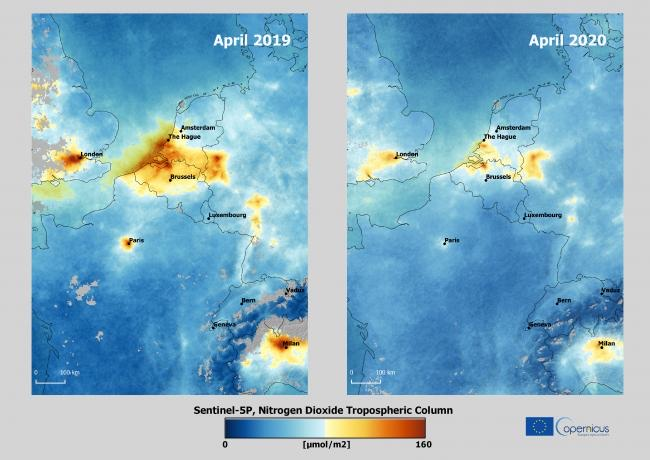

### 초록
추후 작성 예정. 연구목적 → 자료와 분석 설계 → 핵심 수치 → 해석 및 적용 범위를 한 문단으로 작성. 분석 전에 예상 결과를 실제 결과처럼 기입하지말 것.

**주제어:** 야간광량, NO2, 자치구, 용도지역

## 1. 연구 배경 {#background}
 코로나19 유행은 도시 활동과 대기환경 사이의 관계를 관찰할 수 있는 중요한 사례가 되었다. 2020년 3월 22일 국내에서는 강화된 사회적 거리두기가 시행되면서 집단시설 이용과 대면 활동 등이 제한되었다. 이후 4월 20일부터 일부 제한이 완화된 사회적 거리두기가 시행되었으며, 5월 6일부터는 생활 속 거리두기로 전환되었다. [Liu et al. (2020)](https://doi.org/10.3390/rs12101576)은 중국 본토를 대상으로 코로나19 시기의 인간 활동 및 환경 변화를 분석하여 봉쇄 기간 내륙 대부분 지역에서 야간광 복사휘도가 감소하였음을 보고하였다. [서울교통공사 집계 자료](https://scpm.seoul.go.kr/resources/pdf/%EB%B9%85%EB%8D%B0%EC%9D%B4%ED%84%B0%EB%A1%9C_%EB%B3%B8_%EC%84%9C%EC%9A%B8%EC%8B%9C%EB%AF%BC_2020%EB%85%84_210204-210210.pdf)에 따르면 2020년 3월 서울의 지하철 수송인원은 전년 동월 대비 약 39.3% 감소하는 등 코로나19 초기 도시활동의 변화가 실제 이동 양상에서도 나타났다. 이러한 사회적 변화는 도시의 야간광량뿐 아니라 대기 중 NO₂의 분포와 농도 변화에도 영향을 미쳤을 가능성이 있다. 실제로 [Bauwens et al. (2020)](https://doi.org/10.1029/2020GL087978)은 위성 관측자료를 이용하여 코로나19 초기 한국의 주요 도시에서 대기 중 NO₂ 수직 기둥농도가 전년 동기보다 감소한 현상을 확인하였다. 또한 [Venter et al. (2020)](https://doi.org/10.1073/pnas.2006853117)은 여러 국가의 대기오염 관측자료를 기상조건과 함께 분석하여 코로나19 관련 활동 제한 시기에 NO₂를 비롯한 대기오염물질의 감소가 나타났음을 보고하였다. 

<p align="center">
  <br>
  <span style="font-size: 0.85em; color: gray;">코로나19 전후 유럽권 NO₂ 농도 비교(2019 vs 2020) (출처: S5P 위성 관측자료)</span>
</p>

<p align="center">
  <br>
  <span style="font-size: 0.85em; color: gray;">코로나19 전후 야간광량 비교(2019 vs 2020) (출처: 중국 우한 야간 위성영상)</span>
</p>

 대기 중 질소산화물(NOx)은 자동차 내연기관과 산업시설 등 화석연료 연소 과정에서 주로 배출되며, 이 가운데 질소산화물의 주요 구성 물질인 NO₂(이산화질소)는 대기 중 오존 생성과 2차 에어로졸 형성에 관여하며, 교통량과 산업시설의 분포, 에너지 소비 및 배출 활동의 차이에 따라 NO₂ 농도가 공간적으로 다르게 나타나므로 도시 대기질의 특성과 변화를 파악하는 데 중요한 지표로 활용된다. 또한 NO₂의 대기 중 수명은 일사량과 광화학 반응, 대기 경계층의 상태 등에 영향을 받으므로 계절에 따른 농도 변화가 뚜렷하게 나타날 수 있다. 일반적으로 겨울철에는 광화학적 제거가 상대적으로 약하고 대기 중 질소산화물의 수명이 길어지고 농도가 높아지는 경향이 있는 반면, 여름철에는 OH 라디칼과의 반응을 통한 NO₂의 제거가 활발해져 농도가 낮아지는 경향이 있다. 다만 실제 농도는 배출량과 기상조건 등에도 영향을 받는다. 따라서 서로 다른 계절의 농도를 비교하면 배출 활동의 변화와 계절적 대기화학 조건의 차이를 구분하기 어렵다. 이에 NO₂ 농도 변화를 살펴보기 위해서는 동일한 계절과 월을 기준으로 한 전년 동기 비교가 필요하다.[Seinfeld and Pandis (2016)](https://www.wiley.com/en-us/shop/general-chemistry/atmospheric-chemistry-and-physics-from-air-pollution-to-climate-change-3rd-edition-p-9781118947401). 따라서 NO₂는 모든 대기오염을 대표하는 지표라기보다, 교통·산업 등 연소 과정과 밀접하게 관련된 배출 활동 및 그에 따른 대기환경 변화를 살펴보는 데 적합한 지표라는 점에서 본 연구의 분석 대상으로 선정하였다.

 위성 야간광(Nighttime Lights, NTL) 자료는 지표의 인공조명에서 방출되거나 지표면에 반사되어 위성 센서에 도달하는 빛의 복사휘도를 관측하여 야간 인공조명의 공간적 분포와 상대적인 밝기를 나타내는 자료이다. 본 연구에서는 분석 대상 지표면에 해당하는 픽셀의 평균 야간 복사휘도를 ‘야간광량’으로 지칭한다. 야간광량은 행정통계나 현장조사만으로 파악하기 어려운 도시 활동의 공간적 분포를 광역적으로 관측하여 수집할 수 있는 자료라는 장점이 있다. 실제로 [Ma (2018)](https://doi.org/10.3390/rs10071128)는 중국의 VIIRS 야간광량과 소셜미디어 기반 위치 요청량을 비교하여, 야간광량이 위치 요청량의 지역 간 변동을 성 단위 68%, 도시 단위 78%, 현 단위 75% 설명하는 것을 확인하였다. 또한 [Zheng et al. (2023)](https://www.sciencedirect.com/science/article/pii/S0924271623001521)은 1992~2022년 발표된 688편의 동료심사 논문을 검토하여 야간광량이 도시화와 인간 활동의 공간적 범위 및 강도를 파악하는 데 폭넓게 활용되어 왔음을 정리하였다. 그리고 [Bennett and Smith(2017)](https://www.sciencedirect.com/science/article/abs/pii/S0034425717300068)는 다중시기 야간광량 자료가 도시화와 경제활동 등 사회경제적 변화의 시계열적 추정에 활용될 수 있음을 종합적으로 제시하였다. 이러한 선행연구를 바탕으로 야간광량이 도시 내 인간 활동의 공간적 범위와 상대적 강도를 간접적으로 파악하는 대리지표로 활용될 수 있음을 시사한다. 다만 야간광은 인간 활동 자체를 직접 측정하는 지표가 아니며 조명시설의 밀도와 운영시간, 토지이용 특성 및 관측 환경 등에도 영향을 받으므로 해당 측정값을 활동량이나 경제활동과 동일하게 해석해서는 안 된다. 또한 [Ma (2018)](https://www.mdpi.com/2072-4292/10/5/723)의 선행연구의 경우 픽셀 단위의 비교에서는 설명력이 33%로 낮아짐을 확인하였다. 따라서 야간광량이 도시 및 행정구역 수준에서 인간 활동의 상대적 공간 차이를 파악하는 데 유용할 수 있지만, 세부 공간에서 모든 인간 활동을 동일한 수준으로 반영하지는 못한다는 점을 함께 보여준다. [Elvidge et al. (2017)](https://doi.org/10.1080/01431161.2017.1342050); [Zheng et al. (2023)](https://doi.org/10.1016/j.isprsjprs.2023.05.028). 그러므로 본 연구에서 야간광량은 인간의 이동량이나 실제 경제활동량 자체를 직접 측정하는 값이 아니라, 야간 인공조명의 밝기를 통해 도시 기능에 수반되는 활동의 공간적 분포와 상대적인 변화를 간접적으로 나타내는 지표로 정의한다. 이러한 한계를 고려하여 본 연구에서는 야간광량을 단독으로 인간 활동을 판정하는 지표로 사용하지 않고, NO₂ 기둥농도 변화 및 용도지역별 공간적 특성과 함께 비교함으로써 해석의 범위를 제한하고자 한다.

 위성 관측자료를 활용하는 이유는 지상 관측자료를 대체하기 위해서가 아니라, 지상 측정소만으로는 파악하기 어려운 도시 전역의 공간적 분포를 함께 살펴보기 위해서이다. 지상 대기질 측정소는 특정 지점에서 지표면의 NO₂ 농도를 높은 시간 해상도로 관측할 수 있다는 장점이 있지만, 측정소가 설치되지 않은 지역의 공간적 차이를 직접 파악하기 어렵다. 반면 위성 관측자료는 동일한 센서와 관측 체계를 바탕으로 넓은 지역을 공간적으로 연속된 격자 자료로 제공하므로, 행정구역 간 분포와 변화를 비교하는 데 유용하다. [Petetin et al. (2023)](https://acp.copernicus.org/articles/23/3905/2023/)은 지상 측정소 자료와 TROPOMI 관측자료를 함께 분석하여 두 자료가 서로 다른 공간적·시간적 특성을 가지며, 위성자료가 지상 측정소의 공간적 공백을 보완하는 데 활용될 수 있음을 제시하였다. 이러한 선행연구들은 코로나19 시기의 사회·경제적 활동 변화와 함께 야간광 및 대기오염물질 농도 변화가 나타났음을 보여주며, 위성 및 지상 관측자료가 이러한 변화를 분석하는 데 활용될 수 있음을 시사한다.

 본 연구에서 사용하는 야간광량과 NO₂는 각각 도시 활동의 공간적 분포와 연소 관련 대기오염의 변화를 관측한다는 점에서 서로 다른 현상을 나타내지만, 교통·산업·상업 등 도시의 사회·경제적 활동과 연관된다는 공통점이 있다. 야간광량은 다양한 도시 활동에 수반되는 인공조명을 반영하는 반면, NO₂는 그중 화석연료 연소와 관련된 배출 활동 및 대기 중 오염물질의 분포를 반영한다. 따라서 두 지표를 함께 분석하면 도시 활동과 관련된 야간 인공조명의 변화가 연소 관련 대기오염물질의 변화와 공간적으로 어느 정도 일치하는지, 또는 서로 다른 양상으로 나타나는지를 살펴볼 수 있다. 이는 야간광량의 변화만으로는 확인하기 어려운 지역별 대기환경의 차이를 함께 검토할 수 있다는 점에서 의미가 있다. 실제로 [Thongrueang et al. (2023)](https://www.mdpi.com/2071-1050/15/5/4296)은 태국의 코로나19 봉쇄 기간을 대상으로 야간광량과 NO₂의 변화를 함께 분석하였으며, 지리적 가중회귀(GWR) 결과 중심부·서부·북부 지역에서는 두 지표 사이에 양의 지역적 관계가 나타난 반면 주변부에서는 음의 관계가 나타나는 등 지역에 따라 연관성의 방향이 달라질 수 있음을 확인하였다. 이는 야간광량과 NO₂의 관계를 도시 전체의 상관관계로 가정하기보다, 지역의 공간적 특성을 고려하여 분석할 필요가 있음을 보여주는 선행연구이다. 또한 [Sangi et al. (2023)](https://www.jeionline.org/index.php?journal=mys&page=article&op=view&path%5B%5D=202300488)은 이란의 14개 대도시를 대상으로 코로나19 전후 NO₂와 야간광량의 시공간적 변화를 함께 분석하여, 도시별로 두 지표의 변화 양상이 다르게 나타날 수 있음을 검토하였다. 이는 야간광량과 NO₂의 관계를 도시 전체의 단일한 상관관계로 가정하기보다, 지역의 공간적 특성을 고려하여 분석할 필요가 있음을 보여주는 선행연구이다.

   코로나19에 따른 야간광량 변화와 NO₂ 농도 변화가 모든 지역에서 동일하게 나타났다고 보기는 어렵다. 서울시의 자치구는 [국토의 계획 및 이용에 관한 법률](https://www.law.go.kr/%EB%B2%95%EB%A0%B9/%EA%B5%AD%ED%86%A0%EC%9D%98%EA%B3%84%ED%9A%8D%EB%B0%8F%EC%9D%B4%EC%9A%A9%EC%97%90%EA%B4%80%ED%95%9C%EB%B2%95%EB%A5%A0)에 따라 실제 용도지역의 구성과 토지이용 특성에서 차이를 보이며, 이에 따라 코로나19 시기의 활동 변화와 대기오염물질 배출 양상도 서로 다르게 나타날 수 있다. 실제로 [김민호(2021)](https://doi.org/10.16879/jkca.2021.21.2.105)는 서울시 자치구를 대상으로 코로나19 시기의 야간 인공조명 복사휘도 변화를 분석하여 주거지역에서는 야간 인공조명 세기의 증가가, 일부 상업지역에서는 인공조명 세기의 감소가 나타났음을 보고하였다. 또한 NO₂ 변화에 있어서도 [Ku(2020)](https://www.mdpi.com/2071-1050/12/7/2964)는 코로나19 이전에도 대만의 타이베이 및 타이중 지역을 대상으로 토지이용 패턴과 대기오염물질 농도의 관계를 분석하여, 건축물 및 교통 관련 토지이용 특성과 NO₂ 농도 사이에 유의한 관계가 나타날 수 있으며 토지이용 유형에 따라 대기오염과의 관계가 달라짐을 제시하였다. 이러한 선행연구는 도시 기능과 토지이용의 차이를 고려하지 않은 채 도시 전체의 야간광량 및 NO₂ 변화만을 비교할 경우, 지역별로 상이한 변화 양상을 충분히 설명하기 어렵다는 점을 시사한다.

이러한 분석은 사회적·공공적 측면에서도 의미를 가진다. 도시 전체의 평균적인 야간광량이나 대기오염 변화만으로는 어떤 지역의 활동 변화가 컸는지, 그 지역의 대기환경도 같은 방향으로 변화했는지 파악하기 어렵다. 하지만 이러한 연구를 통한 공간을 기준으로 한 정책의 차등적 적용은 한정된 환경관리 자원을 보다 효율적으로 활용하기 위한 측면에서도 의미가 있다. WHO는 대기오염 저감 전략을 수립할 때 교통체계와 산업활동 등 주요 배출원의 특성 및 지역적 여건을 고려해야 하며, 지역·도시·농촌 수준에서 대기질 관리계획을 수립할 것을 권고한다. [WHO, Air quality, energy and health: Strategies; WHO (2023)](https://www.who.int/teams/environment-climate-change-and-health/air-quality-energy-and-health/sectoral-interventions/ambient-air-pollution/strategies). 또한 유럽연합 집행위원회의 대기질 관측망 지침은 인체 건강 보호를 위한 측정 지점을 선정할 때 오염이 집중되는 핫스팟뿐 아니라 일반 인구의 노출을 대표할 수 있는 도시 및 농촌 배경지역도 함께 고려하도록 하고 있다. 이는 대기질 관측망이 일부 측정 지점이나 도시 전체의 평균만으로 구성되어서는 안 되며, 오염 집중지역과 일반적인 생활환경을 대표하는 지역을 함께 파악해야 한다는 원칙을 보여준다. [European Commission, Spatial Representativeness.](https://environment.ec.europa.eu/topics/air/air-quality/spatial-representativeness_en)

실제 지역 단위 대기오염 관리정책의 평가에서도 공간적 접근의 필요성이 확인된다. [Park and Tarui (2024)](https://www.mdpi.com/2071-1050/16/21/9573)는 서울시 저배출구역의 노후 경유차 규제 효과를 분석하여 NO₂ 농도가 약 4.7% 감소한 것으로 추정하였다. [Salas et al. (2021)](https://www.sciencedirect.com/science/article/pii/S1361920920308749)은 마드리드 저배출구역 도입 이후 정책 대상 지역뿐 아니라 인접 지역에서도 NO₂ 감소가 나타났음을 보고하였다. 반면 [Tong et al. (2025)](https://www.nature.com/articles/s44407-025-00030-9)은 런던의 초저배출구역 정책을 분석하여 도입 시기와 적용 범위에 따라 NO₂ 저감 효과가 다르게 나타날 수 있음을 제시하였다. 이러한 사례는 대기오염 관리정책의 효과가 지역과 적용 범위에 따라 달라질 수 있으므로, 정책을 수립하거나 평가하기에 앞서 지역별 차이를 파악하는 과정이 중요함을 시사한다.

나아가 대규모 범지구적 위기의 경험을 관측자료로 축적하고 분석하는 것은 향후 유사한 위기에 대비하기 위한 측면에서도 의미가 있다. [UN 재난위험경감사무국(UNDRR)](https://www.undrr.org/building-risk-knowledge/disaster-data)은 과거 재난자료가 미래 위험을 단독으로 설명할 수는 없지만, 위험 분석과 결합될 경우 단기 예측 및 장기적인 위험모형의 개선에 기여할 수 있다고 제시한다. 또한 [세계보건기구(WHO)](https://www.who.int/publications/i/item/9789240086531)는 코로나19에서 얻은 교훈을 향후 호흡기 감염병 팬데믹의 대비·대응계획에 반영할 필요성을 강조하고 있다. 이러한 맥락에서 본 연구에서 분석한 코로나19 초기 서울시 자치구별 야간광량과 NO₂의 변화 양상은 향후 유사한 대규모 위기가 발생했을 때 지역별 도시활동과 대기환경의 변화를 비교·진단하고, 도시환경 반응을 예측하는 모형을 구축·검증하기 위한 기초자료로 활용될 수 있다. 이는 과거 강우 및 하천 유량 관측자료가 수문 예측모형의 보정과 검증에 활용되어 미래 홍수 시 하천의 유량 변화를 예측하는 데 기여하는 것과 유사한 맥락이다. [NSIP (National Streamflow Information Program)](https://www.nationalacademies.org/publications/10967)따라서 본 연구는 미래 위기의 양상을 직접 예측하기보다는, 향후 위기 상황에서 나타날 도시환경의 변화를 이해하고 예측하는 데 필요한 지역별 반응자료를 축적한다는 점에서도 의의가 있다.
  
본 연구는 이러한 문제의식에 따라 서울시 25개 자치구를 대상으로 2019년과 2020년 3~5월의 Suomi-NPP(Suomi National Polar-orbiting Partnership) 위성에 탑재된 VIIRS(Visible Infrared Imaging Radiometer Suite) 센서의 야간광량 자료와 Sentinel-5P(S5P) 위성의 TROPOMI(TROPOspheric Monitoring Instrument) 센서로 관측한 대류권 NO₂ 수직기둥농도 자료를 결합하여 분석하고자 한다. 먼저 동일한 봄철 기간을 기준으로 자치구별 야간광량과 NO₂ 수직기둥농도의 평균값 및 전년 동기 대비 변화율을 산출하여 지역별 변화 양상을 파악한다. 다음으로 서울시 25개 자치구 전체를 대상으로 야간광량 변화율과 NO₂ 변화율 사이의 상관관계를 분석하여 두 지표의 전반적인 연관성의 방향과 강도를 평가한다. 마지막으로 입지계수(LQ)를 활용하여 주거·상업·공업·녹지 용도지역의 상대적 집중도가 높은 자치구 집단을 구분하고, 각 집단 내부에서 두 지표의 변화율 사이의 상관관계를 개별적으로 분석한 뒤 서울시 전체의 분석 결과와 비교한다. 이를 통해 코로나19 초기 사회적 거리두기 조치의 시행 및 완화 시기 서울시 전반에서 나타난 야간광량과 대기환경 변화의 연관성을 파악하고, 이러한 관계가 도시기능의 상대적 특성에 따라 어떠한 차이를 보이는지 검토하고자 한다.

다만 본 연구는 행정구역 단위의 위성 관측자료를 이용한 공간적 연관성 분석으로, 야간 조명 특성의 변화가 NO₂ 변화에 미친 직접적인 인과관계를 규명하는 데 목적이 있지 않다. 또한 VIIRS 야간광량은 야간에 관측되는 반면 TROPOMI는 주간에 관측되므로, 두 지표가 동일한 시간대의 활동을 반영한다고 볼 수 없다. TROPOMI의 관측 해상도 역시 2019년 8월 이후 약 5.6×3.5 km로 자치구보다 크거나 비슷한 경우가 있어, 행정구역별로 산출한 값이 완전히 독립적인 고해상도 관측값이라고 해석해서는 안 된다. 따라서 본 연구는 동일한 분석 기간과 행정구역 단위를 기준으로 두 지표의 변화 양상과 연관성을 비교하되, 위성자료의 측정 대상과 공간적·시간적 한계 및 집단별 표본수에 따른 통계적 불확실성을 고려하여 결과를 해석하고자 한다.

------------------------------

대기 중 질소산화물(NOx)은 자동차 내연기관과 산업시설 등 화석연료 연소 과정에서 주로 배출되며, 이 가운데 주요 구성 물질인 NO₂(이산화질소)는 대기 중 오존 생성과 2차 에어로졸 형성에 관여한다. 또한 교통량과 산업시설의 분포, 에너지 소비 및 배출 활동의 차이에 따라 NO₂ 농도가 공간적으로 다르게 나타나므로 도시 대기질의 특성과 변화를 파악하는 데 중요한 지표로 활용된다. 다만 NO₂의 대기 중 수명은 일사량과 광화학 반응, 대기 경계층의 상태 등에 영향을 받으므로 계절에 따른 농도 변화가 뚜렷하게 나타날 수 있다. 일반적으로 겨울철에는 광화학적 제거가 상대적으로 약하고 대기 중 질소산화물의 수명이 길어져 농도가 높아지는 경향이 있는 반면, 여름철에는 OH 라디칼과의 반응을 통한 NO₂ 제거가 활발해져 농도가 낮아지는 경향이 있다. 다만 실제 농도는 배출량과 기상조건 등에도 영향을 받는다. 따라서 서로 다른 계절의 농도를 비교하면 배출 활동의 변화와 계절적 대기화학 조건의 차이를 구분하기 어렵다. 이에 NO₂ 농도 변화를 살펴보기 위해서는 동일한 계절과 월을 기준으로 한 전년 동기 비교가 필요하다. [Seinfeld and Pandis (2016)](https://www.wiley.com/en-us/shop/general-chemistry/atmospheric-chemistry-and-physics-from-air-pollution-to-climate-change-3rd-edition-p-9781118947401) 이러한 특성을 고려할 때 NO₂는 모든 대기오염이나 인간활동을 포괄적으로 대표하는 지표라기보다, 교통·산업 등 연소 과정과 밀접하게 관련된 배출 활동 및 그에 따른 대기환경 변화를 살펴보는 데 적합한 지표라는 점에서 본 연구의 분석 대상으로 선정하였다.

위성 야간광(Nighttime Lights, NTL) 자료는 지표의 인공조명에서 방출되거나 지표면에 반사되어 위성 센서에 도달하는 빛의 복사휘도를 관측하여 야간 인공조명의 공간적 분포와 상대적인 밝기를 나타내는 자료이다. 본 연구에서는 분석 대상 지표면에 해당하는 픽셀의 평균 야간 복사휘도를 ‘야간광량’으로 지칭한다. 야간광량은 행정통계나 현장조사만으로 파악하기 어려운 도시 활동의 공간적 분포를 광역적으로 관측하여 수집할 수 있다는 장점이 있다. 실제로 [Ma (2018)](https://doi.org/10.3390/rs10071128)는 중국의 VIIRS 야간광량과 소셜미디어 기반 위치 요청량을 비교하여, 야간광량이 위치 요청량의 지역 간 변동을 성 단위 68%, 도시 단위 78%, 현 단위 75% 설명하는 것을 확인하였다. 또한 [Zheng et al. (2023)](https://www.sciencedirect.com/science/article/pii/S0924271623001521)은 1992~2022년 발표된 688편의 동료심사 논문을 검토하여 야간광량이 도시화와 인간활동의 공간적 범위 및 강도를 파악하는 데 폭넓게 활용되어 왔음을 정리하였다. [Bennett and Smith (2017)](https://doi.org/10.1016/j.rse.2017.01.005)는 다중시기 야간광량 자료가 도시화와 경제활동 등 사회경제적 변화의 시계열적 추정에 활용될 수 있음을 제시하였다. 이러한 선행연구는 야간광량이 인간활동 자체를 직접 측정하지는 않더라도, 도시 및 행정구역 수준에서 인간활동의 상대적인 공간적 분포와 변화를 간접적으로 파악하는 대리지표로 활용될 수 있음을 보여준다. 다만 야간광량은 조명시설의 밀도와 운영시간, 토지이용 특성 및 관측 환경 등에도 영향을 받으므로 관측값을 실제 활동량이나 경제활동과 동일하게 해석해서는 안 된다. 특히 [Ma (2018)](https://www.mdpi.com/2072-4292/10/5/723)의 별도 연구에서는 픽셀 단위의 비교에서 설명력이 33%로 낮아지는 것을 확인하였다. 이는 야간광량이 도시 및 행정구역 수준에서 인간활동의 상대적 공간 차이를 파악하는 데 유용할 수 있지만, 세부 공간에서 모든 인간활동을 동일한 수준으로 반영하지는 못한다는 점을 보여준다. [Elvidge et al. (2017)](https://doi.org/10.1080/01431161.2017.1342050); [Zheng et al. (2023)](https://doi.org/10.1016/j.isprsjprs.2023.05.028) 따라서 본 연구에서는 야간광량을 인간의 이동량이나 실제 경제활동량 자체를 직접 측정하는 값이 아니라, 야간 인공조명의 밝기를 통해 도시 기능에 수반되는 활동의 공간적 분포와 상대적인 변화를 간접적으로 나타내는 지표로 정의한다.

이처럼 NO₂와 야간광량은 각각 연소 과정에 따른 대기환경 변화와 야간 인공조명의 공간적 분포를 관측하는 지표로서, 어느 하나만으로 인간활동과 도시환경의 변화를 온전히 설명하기에는 한계가 있다. 그럼에도 두 지표를 함께 활용할 수 있는 근거는 각각이 도시의 서로 다른 측면을 관측하며, 선행연구에서 두 자료의 결합이 도시활동 및 대기오염의 공간적 분포를 파악하는 데 활용되어 왔다는 점에 있다. 예를 들어 [Wang et al. (2020)](https://doi.org/10.5194/acp-20-6651-2020)은 VIIRS 야간광량과 TROPOMI NO₂ 위성관측 자료 사이의 공간적 관계를 활용하였다. 중국 지역의 0.05° 격자 자료를 분석한 결과, 로그 변환한 야간광량과 TROPOMI NO₂ 기둥농도 사이에서 양의 상관관계(R=0.66)를 확인하였으며, 이를 NO₂ 농도 및 배출량의 공간적 세분화에 활용하였다. 또한 [Thongrueang et al. (2023)](https://doi.org/10.3390/su15054296)은 코로나19 봉쇄에 따른 인위적 활동 변화와 NO₂ 농도 변화를 파악하기 위해 야간광량과 Sentinel-5P NO₂ 자료를 함께 분석하였다. 이 연구에서는 태국의 NO₂ 감소 양상과 함께 지역별로 두 지표의 관계가 서로 다르게 나타날 수 있음을 제시하였다. 이는 야간광량과 NO₂를 동일한 의미의 인간활동 지표로 간주하기보다는, 도시의 야간 인공조명 특성과 대기환경이라는 서로 다른 관측 정보를 결합하여 도시 변화의 양상을 다각적으로 살펴볼 수 있음을 보여준다.

아울러 두 지표의 관계가 도시 전체에서 일률적으로 나타난다고 가정하기 어렵다는 점도 중요하다. [Zheng et al. (2023)](https://doi.org/10.1016/j.isprsjprs.2023.05.028)은 야간광량 자료가 도시화와 사회경제적 변화 등 다양한 연구에 활용되어 왔음을 정리하면서, 자료의 공간적 규모와 변동 요인을 고려한 분석의 필요성을 제시하였다. [Thongrueang et al. (2023)](https://doi.org/10.3390/su15054296)의 코로나19 관련 연구에서도 야간광량과 NO₂의 관계가 지역별로 상이하게 나타났다. 이러한 선행연구는 도시 전체의 평균적인 변화만으로는 지역별 활동 특성과 대기환경 변화의 차이를 충분히 설명하기 어려우며, 두 지표의 관계를 공간적 맥락 속에서 분석할 필요가 있음을 시사한다.

이에 본 연구는 서울시 25개 자치구를 대상으로 위성관측 기반의 야간광량과 NO₂ 자료를 활용하고자 한다. 위성관측 자료는 넓은 공간 범위에 걸쳐 관측 정보를 확보할 수 있어, 개별 지상관측 지점만으로는 파악하기 어려운 도시 전반의 공간적 분포와 지역 간 변화 양상을 비교하는 데 유용하다. 특히 야간광량과 NO₂를 각각 관측하는 위성자료를 활용하면 두 지표의 변화가 서울시 내부에서 어떤 공간적 분포를 보이는지 동일한 행정구역 단위에서 비교할 수 있다. 이는 지상관측 자료의 결측치를 대체하는 목적에 그치지 않고, 위성관측을 통해 공간적 변화 양상을 살펴보고 지상관측 및 추가적인 지역 자료와 연계해 해석할 수 있는 기초 정보를 확보하려는 것이다.

이러한 공간적 분석의 필요성은 대기환경 정책의 방향과도 연결된다. 세계보건기구(WHO)는 정책 담당자와 시민이 각 지역의 대기오염 배출원 및 오염 기여도를 파악하고, 이를 바탕으로 효과적인 배출 저감 전략을 수립해야 한다고 제시하고 있다. 특히 배출원 분석과 지역별 특성을 고려한 정책적 대응의 중요성을 강조한다. [WHO (2024), Air pollution: Personal interventions and risk communication](https://www.who.int/news-room/questions-and-answers/item/air-pollution-personal-interventions-and-risk-communication) 실제로 [Salas et al. (2021)](https://doi.org/10.1016/j.trd.2020.102689)은 스페인 마드리드의 저배출구역(Madrid Central) 도입 효과를 분석하여 정책 적용 중심부의 NO₂ 감소뿐 아니라 인근 관측 지점에서도 유의한 감소가 나타났음을 보고하였다. [Tong et al. (2025)](https://doi.org/10.1038/s44407-025-00030-9)의 런던 초저배출구역(ULEZ) 연구에서도 2019년 중심부 도입 이후 교통량이 많은 관측 지점과 도시 배경 관측 지점에서 각각 19.6%, 8.2%의 NO₂ 감소 효과가 확인되었으나, 2023년 확대 적용에서는 추가적인 감소 효과가 뚜렷하게 확인되지 않았다. 이러한 사례는 특정 공간을 대상으로 한 대기오염 저감 정책이 실제 대기질 개선으로 이어질 수 있음을 보여주는 동시에, 정책 효과가 적용 지역과 시기, 지역별 배출원 구성 등에 따라 달라질 수 있음을 시사한다.

따라서 도시 내부의 지역별 변화 양상과 지표 간 관계를 파악하는 것은 향후 대기환경 관리에서 추가적인 조사와 정책적 대응이 필요한 지역을 검토하기 위한 기초 단계로서 의미가 있다. 이에 본 연구는 코로나19 초기 사회적 거리두기 조치가 시행되고 완화되던 2020년 3~5월을 대상으로, 서울시 25개 자치구의 야간광량과 NO₂ 기둥농도를 전년 동기인 2019년과 비교하고자 한다. 나아가 두 지표의 변화율 사이의 상관관계를 서울시 전체 자치구를 대상으로 분석하고, 입지계수(LQ)를 활용하여 주거·상업·공업·녹지 기능이 상대적으로 집중된 자치구 집단을 구분한 뒤 각 집단에서의 상관관계를 별도로 분석하여 전체 자치구의 관계와 비교하고자 한다. 이를 통해 도시의 기능적 특성에 따라 야간 인공조명과 대기환경의 변화가 어떠한 차이와 공간적 연관성을 보이는지 평가하고자 한다.


## 2. 연구 질문 {#question}
### 2.1 연구 질문 1
>**일상적 질문:** "사회적 거리두기 이전 봄과 비교하면 서울 밤거리의 불빛과 공기 속 이산화질소가 정말 줄었을까? 그냥 기분 탓은 아닐까?"

**학술적 연구 질문:** 같은 계절의 전년 동기인 2019년 봄(3~5월)과 비교한 2020년 봄 서울시 25개 자치구의 야간광량과 NO₂ 대류권 기둥농도의 변화율(%)은 각각 어떠한 값을 보이는가?

### 2.2 연구 질문 2
>**일상적 질문:** "서울시 전체적으로 야간광량이 많이 감소한 자치구일수록 NO₂도 많이 감소했을까? 두 변화는 서로 어떤 관계를 보였을까?"

**학술적 연구 질문:** 서울시 25개 자치구 전체에서 관측된 전년 동기 대비 야간광량 변화율(%)과 NO₂ 기둥농도 변화율(%) 사이의 상관관계는 어떠한 방향과 강도를 나타내는가?

### 2.3 연구 질문 3
>**일상적 질문:** "서울시 전체에서 나타난 두 지표의 관계가 주택가, 상가, 공단, 녹지에서 전부 똑같이 나타날까? 도시 기능에 따라 그 관계가 얼마나 달라질까?"

**학술적 연구 질문:** 주거·상업·공업·녹지 용도지역별 대표 자치구 집단 내부에서 야간광량 변화율과 NO₂ 기둥농도 변화율 간 상관관계의 방향과 강도는 어떠한 양상을 보이며, 서울시 25개 자치구 전체의 상관관계와 비교했을 때 어떠한 차이를 나타내는가?

## 3. 연구 목적 {#objectives}
### 3.1 전체 연구목적
본 연구는 코로나19 사회적 거리두기 조치의 시행 및 완화 시기인 2020년 3~5월을 대상으로 서울시 25개 자치구의 야간광량과 NO₂ 기둥농도를 2019년 동기와 비교하여 전년 동기 대비 변화율(%)을 산출하고, 두 지표의 변화 사이에 나타나는 전체적인 상관관계와 도시 기능에 따른 공간적 연관성의 차이를 분석하는 것을 목적으로 한다.

구체적으로 첫째, 서울시 25개 자치구별 야간광량과 NO₂ 기둥농도의 전년 동기 대비 변화율을 산출하여 지역별 변화 양상을 파악한다(세부목적 1). 둘째, 25개 자치구 전체를 대상으로 야간광량 변화율과 NO₂ 변화율 사이의 상관관계를 분석하여 서울시 전반에서 나타나는 두 지표의 연관성의 방향과 강도를 평가한다(세부목적 2). 셋째, 입지계수(LQ)를 통해 선정한 주거·상업·공업·녹지 용도지역별 대표 자치구 집단 내부에서 두 지표의 상관관계를 각각 분석하고, 이를 전체 자치구의 분석 결과와 비교하여 도시 기능에 따른 연관성의 차이를 평가한다(세부목적 3).

이러한 세부목적은 자치구별 변화율 산출 → 서울시 전체의 상관관계 분석 → 용도지역별 상관관계 분석 및 전체 결과와의 비교 순으로 구성되며, 이를 통해 코로나19 초기 서울시의 야간광량과 NO₂ 변화 사이의 전반적인 관계와 도시 기능에 따른 지역별 연관성의 차이를 파악하고자 한다.

### 3.2 세부목적 1·서울시 25개 자치구의 2020년 3~5월 중 야간광량 관측값과 NO₂ 관측값의 전년 동기 대비 변화율(%)을 산출
- 연구 질문 1의 목적화. 2019년과 2020년 3~5월의 Suomi-NPP 위성 VIIRS 야간광량 자료와 Sentinel-5P 위성 TROPOMI NO₂ 기둥농도 자료를 전년 동기 비교하여 서울시 25개 자치구별 변화율(%)을 산출하고, 두 지표의 지역별 변화 방향과 크기 및 공간적 분포를 파악하고자 한다.

- 필요성 및 평가 지표. 야간광량과 NO₂ 기둥농도는 자치구마다 기존 관측 수준이 달라 절대값만으로는 변화 정도를 비교하기 어렵다. 또한 NO₂는 일사량, 대기 경계층 등 계절·기상 조건의 영향을 받으므로, 동일한 월을 기준으로 한 전년 동기 대비 변화율을 산출하여 계절 차이의 영향을 줄일 필요가 있다. 자치구별 두 지표의 변화율(%)과 그 분포(평균, 중앙값, 최솟값, 최댓값, 표준편차)를 평가 지표로 하여 후속 분석의 기초자료로 제시한다.

### 3.3 세부목적 2·서울시 25개 자치구 전체의 야간광량 변화율과 NO₂ 변화율 간 상관관계를 분석
- 연구 질문 2의 목적화. 서울시 25개 자치구 전체를 대상으로 야간광량 변화율(%)과 NO₂ 기둥농도 변화율(%) 사이의 상관관계를 분석하여, 서울시 전반에서 나타나는 두 지표 변화 사이의 연관성의 방향과 강도를 평가하고자 한다.

- 필요성 및 평가 지표. 야간광량과 NO₂ 기둥농도는 서로 다른 대상을 관측하지만, 모두 교통·산업·상업 등 도시 활동의 영향을 받는다. 따라서 두 변화율의 상관관계를 분석하면 코로나19 초기 서울시 전반에서 두 지표가 같은 방향으로 변했는지 파악할 수 있다. 상관계수(Pearson r 또는 Spearman ρ)의 부호와 크기, p값, 신뢰구간을 평가 지표로 하며, 이 결과를 세부목적 3의 비교 기준으로 삼는다.

### 3.4 세부목적 3·도시지역의 4대 용도지역별 '야간광량 변화율과 NO₂ 변화율 간 상관관계'의 방향과 강도를 평가
- 연구 질문 3의 목적화. 입지계수(LQ)를 통해 선정한 주거·상업·공업·녹지 용도지역별 대표 자치구 집단 내부에서 야간광량 변화율(%)과 NO₂ 기둥농도 변화율(%) 사이의 상관관계를 각각 분석하고, 이를 서울시 25개 자치구 전체의 상관관계와 비교하여 도시 기능에 따른 연관성의 차이를 평가하고자 한다.

- 필요성 및 평가 지표. 서울시 전체의 상관관계는 기능이 다른 자치구를 하나로 묶은 결과이므로, 도시 기능에 따른 차이를 설명하지 못한다. 주거·상업·공업·녹지 지역은 주요 활동과 배출원 구성이 다르므로, LQ로 용도지역별 대표 자치구 집단을 구분하여 집단별 상관관계를 분석할 필요가 있다. 집단별 상관계수의 부호와 크기, p값, 신뢰구간을 평가 지표로 하고, 이를 서울시 전체의 상관관계와 비교한다.

## 4. 재료 {#materials}
대상 지역·기간, 자료 제공기관·GEE ID·버전, 원래 해상도와 사용 밴드, 변수·단위, 표본 구조와 보조자료의 출처를 작성한다. 관측자료·합성자료를 명확히 구분한다. 좌표나 날짜가 없는 예제에는 실제 값을 만들어 넣지 않는다.

## 5. 방법 {#method}
### 5.1 자료 처리 및 기초 분석
구름·수면 마스킹, 단위 변환, 합성·집계, 표본 추출과 필터 조건을 설명한다. 각 처리의 목적과 적용 순서를 기록한다.

### 5.2 세부목적 1의 분석
모형·변수·가정·비교 조건과 추정량 및 구간 산출 방법을 제시한다.

### 5.3 세부목적 2의 분석
집단·시기 정의와 차이의 추정 방법을 기술한다.

### 5.4 세부목적 3의 분석 및 검증
민감도 조건과 평가 단위를 제시한다. 예측 연구에서는 학습·평가 분리와 기준 모형을 명시한다. 실행 코드와 재현 순서를 연결한다.

## 6. 결과 {#results}
### 6.1 표본 구성 및 기초 분포
필터 전후 실제 표본 수와 주요 변수의 분포를 제시한다.

```markdown

```

### 6.2 세부목적 1의 결과
추정값·단위·불확실성을 그림 및 코드와 연결한다.

### 6.3 세부목적 2의 결과
집단별 값과 집단 간 차이를 구분하여 보고한다.

### 6.4 세부목적 3의 결과
조건별 결과 변화, 표본 수, 평가 오차를 보고한다. 예상과 다른 결과도 포함한다.

## 7. 토의 {#discussion}
결과가 연구 질문에 주는 답과 가능한 설명을 논한다. 확인한 문헌과 비교하고, 자료·모형·평가 설계의 한계가 해석에 미치는 영향을 구체화한다. 적용 범위와 이를 넓히기 위한 후속 연구를 제시한다.

## 8. 결론 {#conclusion}
전체 연구목적과 범위를 환기한 뒤 세부목적 1·2·3에 대한 핵심 답을 근거와 함께 요약한다. 본문에 없는 새 결과·인용·주장을 추가하지 않는다. 종합적 기여와 적용 한계를 명시한다.

---

### 부록 · 재현성 및 연구 기여 {#reproduce}
실행 환경·순서·입력 위치·실행 확인일과 조원별 분석·검증·작성 기여, 참고문헌을 기록한다. 부록은 본문 8개 섹션의 번호에 포함하지 않는다.

[섹션별 작성 지침]({{ site.github.repository_url }}/blob/main/05_보고서양식/섹션별_작성지침.md)


#### 연구 배경 참고문헌

- Bauwens, M., Compernolle, S., Stavrakou, T., Müller, J.-F., van Gent, J., Eskes, H., et al. (2020). Impact of coronavirus outbreak on $\text{NO}_2$ pollution assessed using TROPOMI and OMI observations. Geophysical Research Letters, 47(11), e2020GL087978. [https://doi.org/10.1029/2020GL087978](https://doi.org/10.1029/2020GL087978).
- Elvidge, C. D., Baugh, K., Zhizhin, M., Hsu, F. C., & Ghosh, T. (2017). VIIRS night-time lights. International Journal of Remote Sensing, 38(21), 5860–5879. [https://doi.org/10.1080/01431161.2017.1342050](https://doi.org/10.1080/01431161.2017.1342050)
- 김민호. (2021). 코로나19 팬데믹에 따른 서울시 기초자치단체의 야간조도 변화. 한국지도학회지, 21(2), 105–116. [https://doi.org/10.16879/jkca.2021.21.2.105](https://doi.org/10.16879/jkca.2021.21.2.105).
- Liu, Q., Sha, D., Liu, W., Houser, P., Zhang, L., Hou, R., et al. (2020). Spatiotemporal patterns of COVID-19 impact on human activities and environment in Mainland China using nighttime light and air quality data. Remote Sensing, 12(10), 1576. [https://doi.org/10.3390/rs12101576](https://doi.org/10.3390/rs12101576).
- Seinfeld, J. H., & Pandis, S. N. (2016). Atmospheric Chemistry and Physics: From Air Pollution to Climate Change (3rd ed.).
- Venter, Z. S., Aunan, K., Chowdhury, S., & Lelieveld, J. (2020). COVID-19 lockdowns cause global air pollution declines. Proceedings of the National Academy of Sciences, 117(32), 18984–18990. [https://doi.org/10.1073/pnas.2006853117](https://doi.org/10.1073/pnas.2006853117).
- Qiming Zheng, Karen C. Seto, Yuyu Zhou, Shixue You, Qihao Weng. (2023). Nighttime light remote sensing for urban applications: Progress, challenges, and prospects. ISPRS Journal of Photogrammetry and Remote Sensing, 202, 125–141. [https://doi.org/10.1016/j.isprsjprs.2023.05.028](https://doi.org/10.1016/j.isprsjprs.2023.05.028).
- Schwaab, J., Meier, R., Mussetti, G., Seneviratne, S., Bürgi, C., & Davin, E. L. (2021). The role of urban trees in reducing land surface temperatures in European cities. *Nature Communications, 12*, 6763. [https://doi.org/10.1038/s41467-021-26768-w](https://doi.org/10.1038/s41467-021-26768-w).
