### 초록
추후 작성 예정. 연구목적 → 자료와 분석 설계 → 핵심 수치 → 해석 및 적용 범위를 한 문단으로 작성. 분석 전에 예상 결과를 실제 결과처럼 기입하지말 것.

**주제어:** 야간광량, NO2, 자치구, 용도지역

## 1. 연구 배경 {#background}
대기 중 질소산화물(NOx)은 자동차 내연기관과 산업시설 등 화석연료 연소 과정에서 주로 배출되며, 이 가운데 주요 구성 물질인 NO₂(이산화질소)는 대기 중 오존 생성과 2차 에어로졸 형성에 관여한다. 또한 교통량과 산업시설의 분포, 에너지 소비 및 배출 활동의 차이에 따라 NO₂ 농도가 공간적으로 다르게 나타나므로 도시 대기질의 특성과 변화를 파악하는 데 중요한 지표로 활용된다. 다만 NO₂의 대기 중 수명은 일사량과 광화학 반응, 대기 경계층의 상태 등에 영향을 받으므로 계절에 따른 농도 변화가 뚜렷하게 나타날 수 있다. 일반적으로 겨울철에는 광화학적 제거가 상대적으로 약하고 대기 중 질소산화물의 수명이 길어져 농도가 높아지는 경향이 있는 반면, 여름철에는 OH 라디칼과의 반응을 통한 NO₂ 제거가 활발해져 농도가 낮아지는 경향이 있다. 다만 실제 농도는 배출량과 기상조건 등에도 영향을 받는다. 따라서 서로 다른 계절의 농도를 비교하면 배출 활동의 변화와 계절적 대기화학 조건의 차이를 구분하기 어렵다. 이에 NO₂ 농도 변화를 살펴보기 위해서는 동일한 계절과 월을 기준으로 한 전년 동기 비교가 필요하다. [Seinfeld and Pandis (2016)](https://www.wiley.com/en-us/shop/general-chemistry/atmospheric-chemistry-and-physics-from-air-pollution-to-climate-change-3rd-edition-p-9781118947401). 이러한 특성을 고려할 때 NO₂는 모든 대기오염이나 인간활동을 포괄적으로 대표하는 지표라기보다, **교통·산업 등 연소 기반 활동에 수반되는 질소산화물 배출과 그에 따른 대기환경의 공간적 분포 및 변화를 살펴보는 데 적합한 지표라는 점에서 본 연구의 분석 대상으로 선정하였다.**

**본 연구에서 활용하는 Sentinel-5P TROPOMI의 NO₂ 자료는 지표면의 특정 높이에서 측정한 지상 농도가 아니라, 지표부터 대류권 상단까지 대기 기둥에 포함된 NO₂의 양을 나타내는 대류권 수직기둥농도(Tropospheric Vertical Column Density, 이하 NO₂ 기둥농도)이다. 이는 대기 중 NO₂가 수직 방향으로 얼마나 분포하는지를 단위 면적을 기준으로 나타낸 값으로, 지상 관측소의 농도 측정값과는 구분된다. 따라서 NO₂ 기둥농도는 지상에서 사람이 직접 호흡하는 공기의 오염 수준을 그대로 나타내는 값이라기보다, 위성관측을 통해 도시 및 광역 공간의 대기 중 NO₂ 분포와 변화를 파악하기 위한 지표로 이해해야 한다. 또한 NO₂ 기둥농도는 특정 지역의 질소산화물 배출 활동과 관련된 대기 중 NO₂의 누적 분포를 반영하므로, 지상관측 지점에 국한되지 않고 도시 전반의 대기오염 분포를 공간적으로 비교하는 데 활용할 수 있다. 다만 관측값에는 배출 활동뿐 아니라 NO₂의 화학적 생성과 제거 그리고 기상조건 및 주변 지역으로부터의 이동 등도 함께 반영되므로, 오염 물질 배출 활동과 대기환경 변화 사이의 관계를 간접적으로 살펴보는 자료로 해석할 필요가 있다.**

위성 야간광(Nighttime Lights, NTL) 자료는 지표의 인공조명에서 방출되거나 지표면에 반사되어 위성 센서에 도달하는 빛의 복사휘도를 관측하여 야간 인공조명의 공간적 분포와 상대적인 밝기를 나타내는 자료이다. 본 연구에서는 분석 대상 지표면에 해당하는 픽셀의 평균 야간 복사휘도를 ‘야간광량’으로 지칭한다. 야간광량은 행정통계나 현장조사만으로 파악하기 어려운 도시 활동의 공간적 분포를 광역적으로 관측하여 수집할 수 있다는 장점이 있다. 실제로 [Ma (2018)](https://doi.org/10.3390/rs10071128)는 중국의 VIIRS 야간광량과 소셜미디어 기반 위치 요청량을 비교하여, 야간광량이 위치 요청량의 지역 간 변동을 성 단위 68%, 도시 단위 78%, 현 단위 75% 설명하는 것을 확인하였다. 또한 [Zheng et al. (2023)](https://www.sciencedirect.com/science/article/pii/S0924271623001521)은 1992~2022년 발표된 688편의 동료심사 논문을 검토하여 야간광량이 도시화와 인간활동의 공간적 범위 및 강도를 파악하는 데 폭넓게 활용되어 왔음을 정리하였다. [Bennett and Smith (2017)](https://doi.org/10.1016/j.rse.2017.01.005)는 다중시기 야간광량 자료가 도시화와 경제활동 등 사회경제적 변화의 시계열적 추정에 활용될 수 있음을 제시하였다. 이러한 선행연구는 야간광량이 인간활동 자체를 직접 측정하지는 않더라도, 도시 및 행정구역 수준에서 인간활동의 상대적인 공간적 분포와 변화를 간접적으로 파악하는 대리지표로 활용될 수 있음을 보여준다. 실제 인간활동의 변화를 파악하기 위해서는 유동인구 통계, 교통량, 사업체 운영 현황 등 다양한 자료를 수집하고 분석해야 하며, 자료에 따라 공간적 범위와 집계 주기에도 차이가 발생한다. 반면 위성 기반 야간광량 자료는 넓은 지역을 반복적으로 관측하므로, 동일한 관측 기준을 활용하여 도시 전반의 야간 인공조명 변화를 공간적으로 비교할 수 있다.

다만 야간광량은 조명시설의 밀도와 운영시간, 토지이용 특성 및 관측 환경 등에도 영향을 받으므로 관측값을 실제 활동량이나 경제활동과 동일하게 해석해서는 안 된다. 특히 [Ma (2018)](https://www.mdpi.com/2072-4292/10/5/723)의 별도 연구에서는 픽셀 단위의 비교에서 설명력이 33%로 낮아지는 것을 확인하였다. 이는 야간광량이 도시 및 행정구역 수준에서 인간활동의 상대적 공간 차이를 파악하는 데 유용할 수 있지만, 세부 공간에서 모든 인간활동을 동일한 수준으로 반영하지는 못한다는 점을 보여준다. [Elvidge et al. (2017)](https://doi.org/10.1080/01431161.2017.1342050); [Zheng et al. (2023)](https://doi.org/10.1016/j.isprsjprs.2023.05.028). **따라서 본 연구에서는 야간광량을 인간의 이동량이나 실제 경제활동량 자체를 직접 측정하는 값이 아니라, 야간 인공조명의 밝기를 통해 도시 기능에 수반되는 활동의 공간적 분포와 변화를 간접적으로 나타내는 지표로 정의한다.**

이처럼 NO₂와 야간광량은 각각 연소 과정에 따른 대기환경 변화와 야간 인공조명의 공간적 분포를 관측하는 지표로서, 어느 하나만으로 인간활동과 도시환경의 변화를 온전히 설명하기에는 한계가 있다. 그럼에도 두 지표를 함께 활용할 수 있는 근거는 각각이 도시의 서로 다른 측면을 관측하기에, 선행연구에서 두 자료의 결합을 도시활동의 공간에 따른 차이를 파악하는 데 활용하여 왔다는 점에 있다. 예를 들어 [Wang et al. (2020)](https://doi.org/10.5194/acp-20-6651-2020)은 VIIRS 야간광량과 TROPOMI NO₂ 위성관측 자료 사이의 공간적 관계를 활용하였다. 중국 지역의 0.05° 격자 자료를 분석한 결과, 로그 변환한 야간광량과 TROPOMI NO₂ 기둥농도 사이에서 양의 상관관계(R=0.66)를 확인하였으며, 이를 NO₂ 농도 및 배출량의 공간적 세분화에 활용하였다. 또한 [Thongrueang et al. (2023)](https://doi.org/10.3390/su15054296)은 코로나19 봉쇄에 따른 인위적 활동 변화와 NO₂ 농도 변화를 파악하기 위해 야간광량과 Sentinel-5P NO₂ 자료를 함께 분석하여, 태국의 NO₂ 감소 양상과 함께 지역별로 두 지표의 관계가 서로 다르게 나타날 수 있음을 제시하였다. **특히 지역별로 두 지표의 관계가 서로 다른 방향으로 나타날 수 있음을 분석했다는 점에서, 도시 전체의 평균적인 변화뿐 아니라 토지이용별 관계를 구분하여 살펴볼 필요성을 뒷받침한다. 그리고 [Kovács (2022)](https://hal.science/hal-03661866v1/document)는 프랑스의 코로나19 전면 봉쇄 기간을 대상으로 봉쇄 이전인 2014~2019년의 평균 야간광량과 봉쇄 기간 중 NO₂ 감소율 사이의 관계를 분석하여, 기존 도시 활동 수준에 따른 봉쇄 기간 중 대기오염 변화 사이의 공간적 관계를 평가하고자 하였다.** 이러한 선행연구를 통해 야간광량을 도시 활동의 공간적 분포를 파악하는 지표로 활용하는 데 그치지 않고, 지역별 대기오염 변화의 차이를 해석하기 위한 보조 지표로 활용할 수 있다는 가능성을 제시하였다. 다만 [Kovács (2022)](https://hal.science/hal-03661866v1/document)는 관측되는 야간광량과 NO₂를 동일한 의미의 인간활동의 결과로 간주하기보다는, 도시의 야간 인공조명 특성과 대기환경이라는 서로 다른 관측 정보를 결합하여 도시 변화의 양상을 다각적으로 살펴볼 수 있음을 보여준다.

   
  코로나19 전후 유럽권 NO₂ 농도 비교(2019 vs 2020) (출처: S5P 위성 관측자료)

  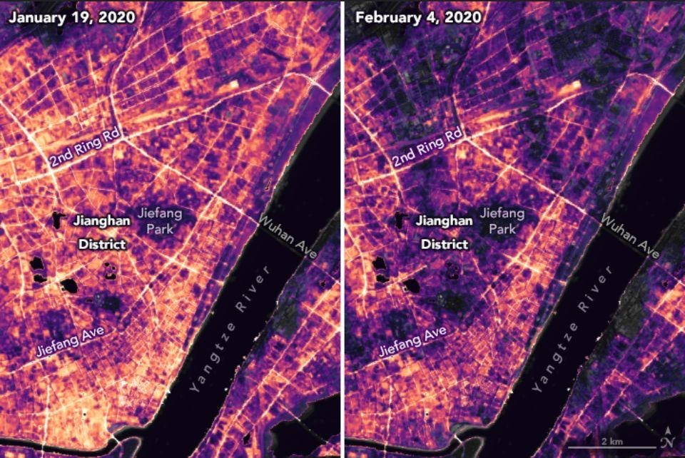 
  코로나19 전후 야간광량 비교(2019 vs 2020) (출처: 중국 우한 야간 위성영상)

아울러 두 지표의 관계가 도시 전체에서 일률적으로 나타난다고 가정하기 어렵다는 점도 중요하다. [Zheng et al. (2023)](https://doi.org/10.1016/j.isprsjprs.2023.05.028)은 야간광량 자료가 도시화와 사회경제적 변화 등 다양한 연구에 활용되어 왔음을 정리하면서, 자료의 공간적 규모와 변동 요인을 고려한 분석의 필요성을 제시하였다. [Thongrueang et al. (2023)](https://doi.org/10.3390/su15054296)의 코로나19 관련 연구에서도 야간광량과 NO₂의 관계가 지역별로 상이하게 나타났다. 이러한 차이는 국내 대도시인 서울을 대상으로 한 연구에서도 확인된 바 있다. [김민호(2021)](https://www.kci.go.kr/kciportal/ci/sereArticleSearch/ciSereArtiView.kci?sereArticleSearchBean.artiId=ART002753773)는 서울시 자치구별 야간 위성영상과 토지피복 자료를 활용하여 2020년 4월과 2021년 4월의 야간광량 변화 양상을 분석하였으며, 그 결과 주거지역에서는 대부분의 자치구에서 야간광량이 증가한 반면, 상업지역에서는 일부 지역에서 감소하는 등 토지이용 유형에 따라 서로 다른 변화 양상이 나타났다. 이는 국내의 동일한 도시 내부에서도 야간광량 변화가 균일하게 나타나지 않았음을 보여준다. 이러한 선행연구는 도시 전체의 한 지표의 평균적인 변화만으로는 지역별 활동과 대기환경 변화의 차이를 충분히 설명하기 어려움을 나타낸다. 따라서 서울시의 야간광량과 NO₂ 변화 관계를 분석할 때에도 도시 전체의 평균적인 관계만 살펴보는 데 그치지 않고, 지역별 기능에 따라 구분하여 비교할 필요가 있다. 

이에 본 연구는 서울시 25개 자치구를 대상으로 위성관측 기반의 야간광량과 NO₂ 자료를 활용하고자 한다. 위성관측 자료는 넓은 공간 범위에 걸쳐 관측 정보를 확보할 수 있어, 개별 지상관측 지점만으로는 파악하기 어려운 도시 전반의 공간적 분포와 지역 간 변화 양상을 비교하는 데 유용하다. 특히 야간광량과 NO₂를 각각 관측하는 위성자료를 활용하면 두 지표의 변화가 서울시 내부에서 어떤 공간적 분포를 보이는지 동일한 행정구역 단위에서 비교할 수 있다. 이는 지상관측 자료의 결측치를 대체하는 목적에 그치지 않고, 위성관측을 통해 공간적 변화 양상을 살펴보고 지상관측 및 지역 자료와 연계해 해석할 수 있는 추가 자료를 확보하려는 것이다. **아울러 위성관측 자료는 광범위한 지역을 반복적으로 관측할 수 있어, 팬데믹과 같은 긴급 상황에서 지역별 환경 변화를 신속하게 비교하고 파악하는 데에도 활용할 수 있다. 이는 현장조사나 행정통계의 집계만으로는 즉각적으로 파악하기 어려운 공간적 변화에 대응하기에 적합한 정보를 제공할 수 있다.**

**다만 야간광량과 NO₂ 위성자료는 관측 시간대와 측정 대상에 차이가 있다. 야간광량은 01시 30분 경의 야간 인공조명의 복사휘도를 관측하는 반면, NO₂ 자료는 13시 30분 경 주간에 관측한 NO₂ 기둥농도를 산출한다. 따라서 두 자료의 관계를 동일 시점의 인간활동과 대기오염 간 관계로 해석하기는 어렵다. 이에 본 연구에서는 이러한 차이를 고려하여 개별 관측 시점의 직접적인 대응 관계보다는 동일한 기간에 나타난 두 지표의 전년 동기 대비 변화율에 집중하여, 이동 제한에 따른 인간 활동 변화와 NO₂ 변화가 토지 용도별 관계의 차이를 알아보기 위해 둘을 함께 사용 공간적 연관성을 분석하고자 한다.**

이러한 공간적 분석의 필요성은 환경 정책의 방향과도 연결된다. 세계보건기구(WHO)는 정책 담당자와 시민이 각 지역의 대기오염 배출원 및 오염 기여도를 파악하고, 이를 바탕으로 효과적인 배출 저감 전략을 수립해야 한다고 제시하고 있다. 특히 배출원 분석과 지역별 특성을 고려한 정책적 대응의 중요성을 강조한다. [WHO (2024), Air pollution: Personal interventions and risk communication](https://www.who.int/news-room/questions-and-answers/item/air-pollution-personal-interventions-and-risk-communication). 실제로 [Salas et al. (2021)](https://doi.org/10.1016/j.trd.2020.102689)은 스페인 마드리드의 저배출구역(Madrid Central) 도입 효과를 분석하여 정책 적용 중심부의 NO₂ 감소뿐 아니라 인근 관측 지점에서도 유의한 감소가 나타났음을 보고하였다. [Tong et al. (2025)](https://doi.org/10.1038/s44407-025-00030-9)의 런던 초저배출구역(ULEZ) 연구에서도 2019년 중심부 도입 이후 교통량이 많은 관측 지점과 도시 배경 관측 지점에서 각각 19.6%, 8.2%의 NO₂ 감소 효과가 확인되었으나, 2023년 확대 적용에서는 추가적인 감소 효과가 뚜렷하게 확인되지 않았다. 이러한 사례는 특정 공간을 대상으로 한 대기오염 저감 정책이 실제 대기질 개선으로 이어질 수 있음을 보여주는 동시에, 정책 효과가 적용 지역과 시기, 지역별 배출원 구성 등에 따라 달라질 수 있음을 나타낸다.

그리고 코로나19와 같은 대규모 사회적 위기 상황에서 지역별 환경 변화를 파악하는 것은 환경관리뿐 아니라 공공보건과 환경 형평성 측면에서도 중요하다. 사회적 거리두기 조치는 교통 및 경제활동을 포함한 도시 활동 전반에 변화를 가져왔지만, 그 영향이 모든 지역과 배출원에 동일하게 나타나는 것은 아니다. [Kerr et al. (2021)](https://doi.org/10.1073/pnas.2022409118)은 미국의 위성관측 자료를 활용하여 코로나19 시기 도시 내부의 NO₂ 감소 양상이 지역별로 달랐으며, 일부 사회경제적 취약 집단이 거주하는 지역에서는 NO₂가 감소한 이후에도 다른 지역보다 높은 오염 수준이 지속될 수 있음을 보고하였다. 또한 [Cooper et al. (2022)](https://doi.org/10.1038/s41586-021-04229-0)은 전 세계 215개 도시의 코로나19 시기 NO₂ 변화를 분석하여, 변화 정도가 지역과 배출 부문에 따라 달라지며 도시 내부에서도 공간적 편차가 나타날 수 있음을 제시하였다. **이러한 연구는 코로나19와 같은 사회적 위기 상황에서도 환경 변화와 관리 필요성이 지역마다 다르게 나타날 수 있으므로, 한정된 지원물자와 행정 자원 및 대응 인력을 효율적으로 배분하기 위해서는 지역별 변화 양상과 특성을 파악하는 공간적 분석이 필요함을 보여준다.**

따라서 도시 내부의 지역별 변화 양상과 지표 간 관계를 파악하는 것은 향후 대기환경 관리에서 추가적인 조사와 정책적 대응이 필요한 지역을 검토하기 위한 기초 단계로서 의미가 있다. 이에 본 연구는 코로나19 초기 사회적 거리두기 조치가 시행되고 완화되던 2020년 3~5월을 대상으로, 서울시 25개 자치구의 야간광량과 NO₂ 기둥농도를 전년 동기인 2019년과 비교하고자 한다. 나아가 두 지표의 변화율 사이의 상관관계를 서울시 전체 자치구를 대상으로 분석하고, 입지계수(LQ)를 활용하여 주거·상업·공업·녹지 기능이 상대적으로 집중된 자치구 집단을 구분한 뒤 각 집단에서의 상관관계를 별도로 분석하여 전체 자치구의 관계와 비교하고자 한다. 이를 통해 도시의 기능적 특성에 따라 야간 인공조명과 대기환경의 변화가 어떠한 차이와 공간적 연관성을 보이는지 평가하고자 한다.

## 2. 연구 질문 {#question}
### 2.1 연구 질문 1
>**일상적 질문:** "사회적 거리두기 전년 봄과 비교하면 서울 밤거리의 불빛과 공기 속 이산화질소가 대중의 인식처럼 정말 줄었을까? 아니면 늘었을까?"

**학술적 연구 질문.** 전년 동기인 2019년 봄(3~5월)과 비교한 2020년 봄 서울시 25개 자치구의 야간광량과 NO₂ 기둥농도의 변화율(%)은 각각 어떠한 값을 보이는가?

### 2.2 연구 질문 2
>**일상적 질문:** "서울시 전체적으로 야간광량이 변한 자치구에서 NO2 는 어떻게 변했을까? 두 변화간에 관계가 있을까?"

**학술적 연구 질문.** 서울시 전체 자치구를 표본으로 하여 관측된 전년 동기 대비 야간광량 변화율(%)과 NO₂ 기둥농도 변화율(%) 사이의 상관관계는 어떠한 방향과 강도를 나타내는가?

### 2.3 연구 질문 3
>**일상적 질문:** "서울시 자치구 전체가 표본일 때 나타난 두 지표의 관계가 주택가, 상가, 공단, 녹지에서 전부 똑같이 나타날까? 도시 기능에 따라 그 관계가 얼마나 달라질까?"

**학술적 연구 질문.** 주거·상업·공업·녹지 용도지역별 선별한 자치구 집단 내부에서 야간광량 변화율과 NO₂ 기둥농도 변화율 간 상관관계의 방향과 강도는 어떠한 양상을 보이며, 25개 전체 자치구를 고려했을 때와 어떠한 차이를 나타내는가?

## 3. 연구 목적 {#objectives}
### 3.1 전체 연구목적
본 연구는 코로나19 사회적 거리두기 조치의 강화 시행 및 완화 시기인 2020년 3~5월을 대상으로 서울시 25개 자치구의 야간광량과 NO₂ 기둥농도를 2019년 동기와 비교하여 두 지표 변화율 간 관계를 정량화하고, 그 관계가 도시 기능에 따라 어떻게 달라지는지 평가하는 것을 목적으로 한다.

먼저 서울시 25개 자치구마다 야간광량과 NO₂ 기둥농도의 전년 동기 대비 변화율을 산출하여 지역별 변화 양상을 파악한다(세부목적 1). 그 다음 25개 자치구 전체를 대상으로 두 지표 변화율 간 상관관계의 방향과 강도를 정량화한다(세부목적 2). 마지막으로 입지계수(LQ)로 선정한 주거·상업·공업·녹지 용도지역별 대표 자치구 집단 내부의 상관관계를 각각 산출하고, 이를 전체 자치구의 결과와 비교하여 도시 기능에 따른 상관관계의 차이를 평가한다(세부목적 3).

이러한 세부목적은 **자치구별 변화율 산출 → 서울시 전체의 상관관계 분석 → 용도지역별 상관관계 분석 및 전체 결과와의 비교** 순으로 구성되며, 이를 통해 사회적 거리두기 강화 시행의 전년도 대비 서울시의 야간광량과 NO₂ 변화 사이의 관계와 도시 기능에 따른 지역별 차이를 파악하고자 한다.

### 3.2 세부목적 1 · 서울시 25개 자치구의 2020년 3~5월 야간광량 관측값과 NO₂ 관측값의 전년 동기 대비 변화율(%)을 산출
**연구 질문 1의 목적화.** 2019년과 2020년 3~5월의 Suomi NPP 위성 VIIRS 야간광량 자료와 Sentinel-5P 위성 TROPOMI NO₂ 기둥농도 자료를 전년 동기와 비교하여 서울시 25개 자치구별 변화율(%)을 산출하고, 두 지표의 지역별 변화 방향과 크기 및 공간적 분포를 파악한다.

**필요성 및 평가 지표.** 야간광량과 NO₂ 기둥농도는 자치구마다 기준 시점(2019년)에 대한 변화율이 달라 절대값만으로는 변화 정도를 비교하기 어렵다. 또한 NO₂는 일사량, 대기 경계층 등 계절·기상 조건의 영향을 받으므로, 전년 동기 대비 변화율을 산출하여 계절 차이의 영향을 줄일 필요가 있다. 자치구별 두 지표의 변화율(%)과 그 분포(평균, 표준편차, 등)를 평가 지표로 하여 후속 분석의 기초자료로 제시한다.

### 3.3 세부목적 2 · 서울시 25개 자치구 전체의 야간광량 변화율과 NO₂ 변화율 간 관계 정량화
**연구 질문 2의 목적화.** 서울시 25개 자치구 전체를 대상으로 야간광량 변화율(%)과 NO₂ 기둥농도 변화율(%) 사이의 상관관계를 산출하여 방향과 강도를 정량화한다.

**필요성 및 평가 지표.** 야간광량과 NO₂ 기둥농도는 서로 다른 대상을 관측하지만, 모두 교통·산업·상업 등 도시 활동의 영향을 받는다. 따라서 두 변화율의 상관관계를 분석하면 코로나19 초기 서울시 전반에서 두 지표가 같은 방향으로 변했는지 파악할 수 있다. 상관계수의 부호와 크기, p값, 신뢰구간을 평가 지표로 하며, 이 결과를 세부목적 3의 비교 기준으로 삼는다.

### 3.4 세부목적 3 · 도시지역의 4대 용도지역별 대표 자치구 집단의 '야간광량 변화율과 NO₂ 변화율 간 관계'의 방향과 강도를 평가
**연구 질문 3의 목적화.** 입지계수(LQ)를 통해 주거·상업·공업·녹지 용도지역별로 선정한 각 대표 집단 내부에서 야간광량 변화율(%)과 NO₂ 기둥농도 변화율(%) 사이의 상관관계를 산출하고, 이를 서울시 25개 자치구 전체를 고려했을 때와 비교하여 도시 기능에 따른 연관성의 차이를 평가한다

**필요성 및 평가 지표.** 서울시 전체의 상관관계는 기능이 다른 자치구를 하나로 묶은 결과이므로, 도시 기능에 따른 차이를 반영하지 못할 수 있다. 주거·상업·공업·녹지 지역은 주요 활동과 배출원 구성이 다르므로, LQ로 용도지역별 대표 자치구 집단을 구분하여 집단별 상관관계를 분석할 필요가 있다. 집단별 상관계수의 부호와 크기, p값, 신뢰구간을 평가 지표로 하고, 이를 25개 자치구 전체 집단의 상관관계와 비교한다.

## 4. 재료 {#materials}
### 4.1 연구 대상 및 분석 기간
본 연구는 2019년과 2020년 3~5월의 서울시 25개 자치구를 대상으로 VIIRS 야간광량과 Sentinel-5P TROPOMI NO₂ 자료를 수집·가공하여 분석하였다. 최종 회귀분석에는 자치구별 야간광량 계절 요약자료와 NO₂ 월별 공간평균자료를 사용하였다.

야간광량 자료는 25개 자치구별로 2019년 봄 평균, 2020년 봄 평균, 두 연도의 변화량 및 변화율을 정리한 [25행의 요약자료](figures/NTL원자료정리.csv)로 구성된다. NO₂ 자료도 마찬가지로 2019년 봄 평균, 2020년 봄 평균, 두 연도의 유효관측개월수 및 변화율을 정리한 [25행의 요약자료](figures/NO2원자료정리.csv)으로 구성된다.

두 위성자료 모두 월별 단위의 분석을 위해 채택하였으나, 월별 자료의 구축 및 최종 산출 과정에는 차이가 있다. VIIRS 자료는 위성 관측값을 월 단위로 합성한 자료가 GEE 컬렉션에서 제공되므로, 해당 월의 합성 복사휘도를 대상으로 자치구별 공간 평균을 산출하였다. 반면 Sentinel-5P/TROPOMI NRTI 자료는 일별 L3 관측자료를 대상으로 분석 월에 해당하는 영상을 수집한 뒤, 월별 평균 영상을 생성하고 이를 자치구별로 집계하였다. 따라서 두 자료는 월별 대표값을 활용한다는 공통점이 있으나, VIIRS는 제공 단계에서 월별 합성이 이루어진 반면 NO₂는 연구 과정에서 월별 평균을 산출하였다는 차이가 있다.

   
  자료의 공간집계 방식 비교

또한 야간광량 분석 코드는 [southkorea/seoul-maps](https://github.com/southkorea/seoul-maps)의 JUSO 2015 비단순화 GeoJSON을 복원해 EPSG:4326으로 읽고, SIG_KOR_NM 필드로 자치구 경계를 dissolve한 뒤 25개 구 포함 여부를 확인하였다. 경계는 2015년 기준으로 고정되어 2019·2020년 경계 변동을 반영하지 않는다. NO₂ 스크립트는 별도의 [seoul_sigungu.shp](figures/seoul_sigungu.zip)를 읽어 EPSG:4326으로 바꾼 뒤 Earth Engine FeatureCollection으로 변환한다. 야간광량과 NO₂ 자료는 서로 다른 수집 및 처리 환경을 통해 구축되었으므로, 각 자료의 공간 집계 과정에 적합한 별도의 자치구 경계자료를 사용하였다. 두 공간자료는 서로 다른 출처와 제작 과정을 거쳤으나, 공간적 비교의 기준을 통일하기 위해 모두 EPSG:4326 좌표계로 변환하여 사용하였다. 다만 동일한 좌표계를 적용하였더라도 원자료의 제작 시점과 경계 구축 방식이 다르므로 자치구 경계의 세부적인 위치 및 면적에 차이가 존재할 수 있다.

### 4.2 야간광량 자료

야간광량 자료는 Google Earth Engine(GEE)의 NOAA/VIIRS/DNB/MONTHLY_V1/VCMSLCFG 컬렉션을 사용하였다. 이 자료는 Suomi NPP 위성 VIIRS 센서의 주야간 밴드(DNB)를 미광 보정하여 월 단위로 합성한 것으로, 공간 해상도는 15초각(약 460m)이다. VIIRS는 현지 시각 약 01시 30분에 관측하므로, 이 자료는 심야 시간대의 인공조명을 반영한다. 분석 변수는 월평균 복사휘도인 avg_rad(nW/cm²/sr)이며, 월 합성에 사용된 구름 없는 관측 횟수인 cf_cvg는 유효 픽셀 선별에 사용하였다. 수역 제외에는 MODIS/006/MOD44W의 2015년 육지·수면 자료를 사용하였다. 처리 기준은 5.1.1에 제시하였다. [VIIRS](https://developers.google.com/earth-engine/datasets/catalog/NOAA_VIIRS_DNB_MONTHLY_V1_VCMSLCFG), [MOD44W](https://developers.google.com/earth-engine/datasets/catalog/MODIS_006_MOD44W).

avg_rad에는 0보다 작은 값이 포함될 수 있다. 이는 실제 빛의 양이 음수라는 뜻이 아니라 관측 및 보정 과정에서 생기는 추정값의 특성이다. 본 연구에서는 음수값을 0으로 바꾸거나 제외하지 않고, 다른 유효 조건을 충족하면 원자료 값을 자치구 평균 산출에 포함하였다. 최종 야간광량 자료에는 25개 자치구의 2019·2020년 봄철 평균값, 변화량, 변화율과 연도별 최소 유효 면적 비율이 기록되어 있으며, 25개 자치구 모두 두 연도의 최소 유효 면적 비율이 1.0이었다.

  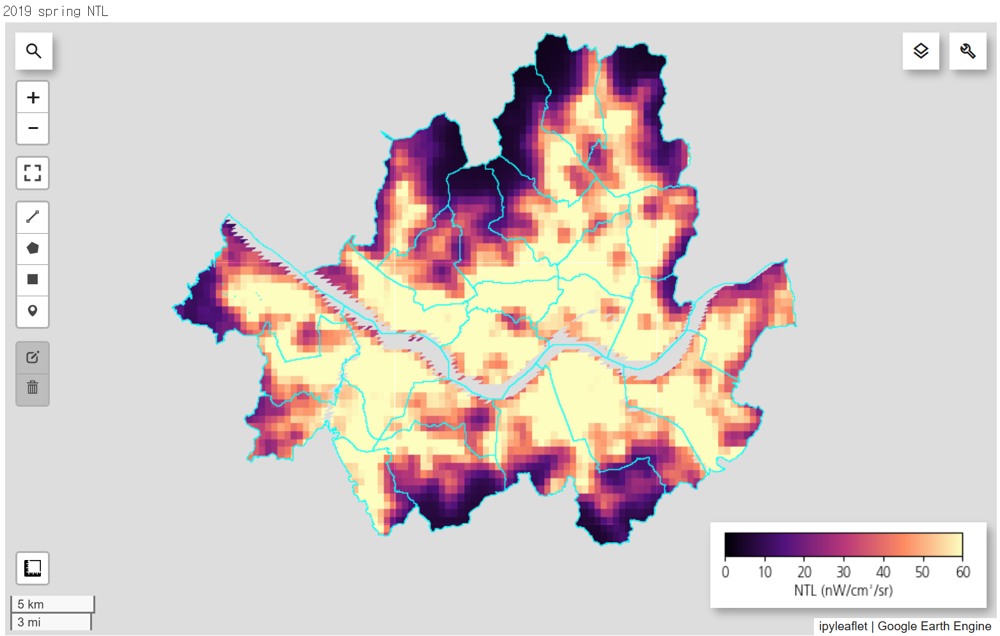 
  2019년 NTL 관측값 (전체 평균)

  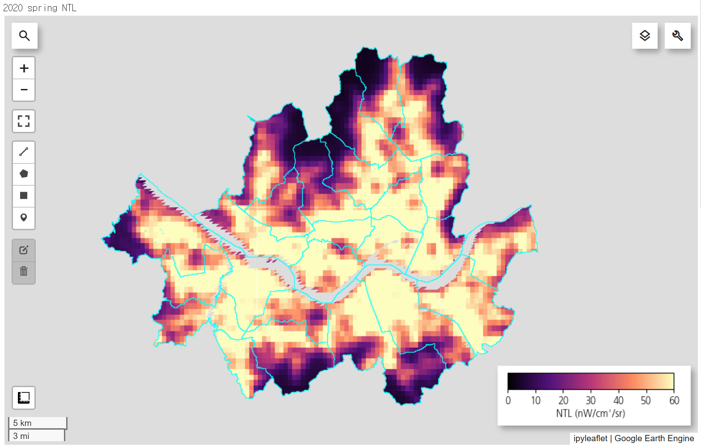 
  2020년 NTL 관측값 (전체 평균)

### 4.3 NO2 자료
NO₂ 자료는 GEE의 COPERNICUS/S5P/NRTI/L3_NO2 컬렉션에서 tropospheric_NO2_column_number_density 밴드, 즉 NO₂ 대류권 기둥농도(이하 NO₂ 기둥농도, mol/m²)를 사용하였으며, 분석 기간은 2019년과 2020년의 3~5월이다. Sentinel-5P 위성의 TROPOMI 센서는 현지 시각 약 13시 30분에 관측하므로, 이 자료는 한낮의 교통·산업 활동에 따른 배출을 주로 반영한다. 센서의 원래 픽셀 크기는 2019년 8월 6일 이전 약 3.5 × 7.2 km, 이후 약 3.5 × 5.5 km로, 비교하는 두 시기의 원 해상도가 다르다. GEE는 원자료(L2)를 1,113.2m 격자의 L3 자료로 변환하여 제공하며, 이 과정에서 대류권 NO₂ 기둥농도의 품질 지표(qa_value)가 0.75 미만인 픽셀은 제거된다. 본 연구에서는 이 품질 기준이 적용된 L3 자료를 사용하였다. [S5P NRTI](https://developers.google.com/earth-engine/datasets/catalog/COPERNICUS_S5P_NRTI_L3_NO2)

  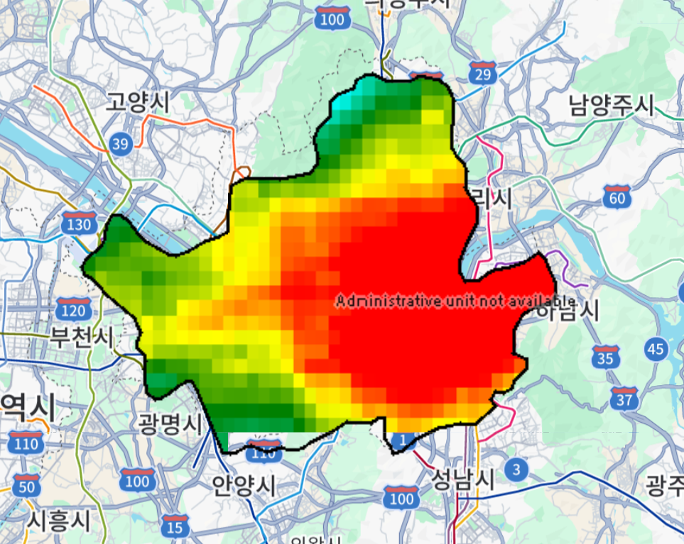 
  2019년 NO2 기둥농도 관측값 (5월 기준)

  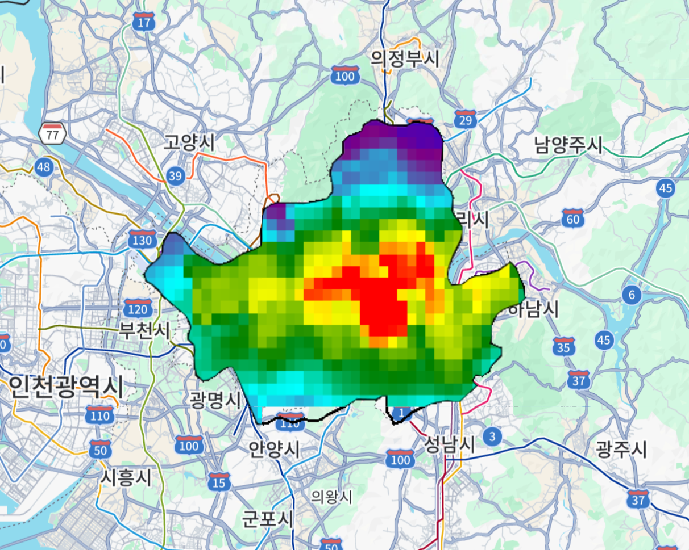 
  2020년 NO2 기둥농도 관측값 (5월 기준)

### 4.4 보조 자료

자치구별 용도지역 특성을 구분하기 위해 [서울 열린데이터광장](https://data.seoul.go.kr/dataList/OA-681/S/1/datasetView.do)에서 제공하는 서울시 용도지역 현황 통계에서 2019년 자치구별 주거·상업·공업·녹지지역 면적을 사용하였다. LQ 산출 방법과 분류 결과는 5.4.1에 제시하였다. [LQ자료](figures/LQ자료.xlsx).

## 5. 방법 {#method}

### 5.1 자료 처리 및 기초 분석

### 5.1.1 야간광량 자료 전처리

   
  VIIRS 야간광량 전처리 방법

VIIRS 월별 합성자료에서 자치구별 야간광량을 산출하기 위해 먼저 수면 영역과 유효하지 않은 관측 픽셀을 제외하였다. 육지 영역은 MODIS/006/MOD44W의 2015년 자료에서 water_mask 밴드를 이용하여 구분하였으며, water_mask 값이 0인 픽셀을 육지로 분류하였다. 이때 water_mask_QA를 함께 활용하여 값이 10인 자료 미존재 영역을 제외하였다. 따라서 본 연구의 마스크는 자료 미존재 영역을 제외하되, QA 값이 10이 아닌 나머지 분류를 모두 포함하는 방식으로 적용하였다.

이후 월별 구름 없는 관측 횟수를 나타내는 cf_cvg가 3회 이상인 픽셀만 유효 픽셀로 선정하였다. 이는 한두 차례의 관측만으로 산출된 월평균 복사휘도가 해당 월의 대표값으로 사용되는 것을 제한하고, 최소한의 관측 횟수를 확보하기 위한 것이다. 다만 3회라는 기준은 제공기관이 지정한 필수 기준이 아니라, 본 연구에서 설정한 최소 관측 횟수 조건이다.

이후 자치구별 전체 분석 육지 면적 대비 유효 관측 면적의 비율을 계산하고, 그 비율이 80% 이상인 경우에만 해당 월의 자치구 평균을 채택하였다. 이를 통해 일부 지역에서 유효 관측 면적이 지나치게 작아 발생할 수 있는 대표성 저하를 줄이고자 하였다. 결측값은 0으로 대체하지 않았으며, 품질 기준을 충족하지 못한 자료는 분석에서 제외하도록 처리하였다. 80%는 자료 제공기관의 공식 기준이 아닌 연구상 설정값이다.

실제 분석 결과, 2019년과 2020년 3~5월에 해당하는 총 150개 자치구-월 자료 모두 유효 면적 비율이 100%로 산출되었다. 따라서 80% 기준에 따라 제외된 자치구-월 자료는 없었다. 여기서 유효 면적 비율 100%는 분석 대상 육지 면적 전체에서 해당 월의 유효 픽셀을 확보했다는 의미이며, 해당 월의 모든 날짜에 걸쳐 관측이 이루어졌다는 의미는 아니다.

본 연구에서는 USE_COMMON_PIXELS=False로 설정하여 각 월에 유효한 픽셀을 독립적으로 사용하였다. 이는 2019년과 2020년의 6개월 전체에서 공통으로 유효한 픽셀만 사용하는 경우 특정 월의 관측 조건으로 인해 다른 월의 유효한 자료까지 제외될 수 있기 때문이다. 다만 실제 분석 결과에서는 6개월 전체의 공통 유효 육지 면적 비율도 모든 자치구에서 100%로 산출되었다. 따라서 이번 자료에서는 공통 유효 영역의 면적 부족으로 인해 월별 분석 영역이 크게 달라지는 현상은 확인되지 않았다.

### 5.1.2 자치구별 월간 야간광량 산출

월별 자치구 평균 야간광량은 유효 픽셀의 야간광량과 면적을 이용한 면적가중 평균으로 산출하였다. 자치구 내 유효 픽셀의 야간광량에 해당 픽셀의 면적을 곱한 값을 합산한 후, 유효 픽셀 면적의 합으로 나누었다.

$$
\bar{R}_{d,y,m}=\frac{\sum_{i} R_{i,y,m}\,A_{i,d}}{\sum_{i} A_{i,d}}
$$

여기서 $$\bar{R}_{d,y,m}$$은 자치구 $$d$$의 연도 $$y$$, 월 $m$의 평균 야간광량, $$R_{i,y,m}$$은 해당 월 픽셀 $$i$$의 평균 복사휘도(avg_rad), $$A_{i,d}$$는 픽셀 $i$ 중 자치구 $$d$$에 포함되는 면적이다. 계산에는 유효 픽셀 조건을 충족한 픽셀만 포함하였다.

이 과정에서 픽셀별 관측 횟수(cf_cvg)를 야간광량에 추가적인 가중치로 적용하지 않았다. 관측 횟수는 유효 관측 여부를 판별하는 품질 기준으로 사용하였으며, 월평균 야간광량은 면적을 기준으로 산출하였다.

### 5.1.3 3개월 통합 야간광량 산출

자치구별 봄철 야간광량 대표값은 3월, 4월, 5월에 산출된 월별 공간평균값을 동일한 가중치로 산술평균하여 계산하였다. 월별 평균 관측 횟수(mean_clear_observations)는 별도로 산출하였으나, 계절 대표값 계산에는 가중치로 반영하지 않았다.

$$
NTL^{spring}_{d,y}=\frac{1}{3}\sum_{m=3}^{5}\bar{R}_{d,y,m}
$$

여기서 $$NTL^{spring}_{d,y}$$는 자치구 $$d$$의 연도 $$y$$에 대한 봄철 야간광량 대표값이며, $$\bar{R}_{d,y,m}$$은 해당 자치구의 $m$월 야간광량 공간평균값이다.

### 5.1.4 NO₂ 자료 전처리 및 통합

   
  Sentinel-5P NO₂ 전처리 방법

NO₂ 자료는 COPERNICUS/S5P/NRTI/L3_NO2 컬렉션에서 분석 대상 지역과 기간을 필터링한 뒤, 2019년과 2020년 각각 3~5월의 월별 평균 영상을 생성하였다. 이 자료는 4.3에서 설명한 L3 변환 단계의 품질 기준이 이미 적용된 자료이다.

월별 영상 간 유효 영역 차이로 인해 비교 대상 픽셀이 달라지는 문제를 줄이기 위해 각 연도별로 3~5월 월별 평균 영상의 유효 마스크를 교차하여 공통 픽셀 영역을 생성하였다. 이 공통 마스크를 각 월별 평균 영상에 동일하게 적용한 뒤, 자치구 경계를 기준으로 ee.Reducer.mean()을 사용하여 자치구별 월평균 NO₂ 기둥농도를 산출하였다.

최종적으로 회귀분석에 사용한 NO₂ 봄철 대표값은 자치구별 3~5월 월평균값을 동일한 가중치로 산술평균하여 산출하였다. 즉, 월별 유효 픽셀 수를 가중치로 적용한 별도의 공간 픽셀 수 가중평균 방식이 아니라, 각 월의 자치구별 공간평균값을 다시 산술평균한 값이다.

$$
NO_2{}^{spring}_{d,y}=\frac{1}{3}\sum_{m=3}^{5}\overline{NO_2}_{d,y,m}
$$

여기서 $$NO_2{}^{spring}_{d,y}$$는 자치구 $$d$$의 연도 $$y$$에 대한 봄철 NO₂ 대표값이며, $$\overline{NO_2}_{d,y,m}$$은 해당 자치구의 $$m$$월 NO₂ 공간평균값이다.

야간광량은 모든 월의 유효 면적 비율이 100%여서 월별 유효 픽셀을 그대로 사용하였으나, NO₂는 구름 등으로 월마다 유효 영역이 달라지므로 같은 영역끼리 비교하기 위해 공통 픽셀 마스크를 적용하였다.

### 5.1.5 공간적 범위의 일치

VIIRS 야간광량과 Sentinel-5P NO₂ 자료는 서울시 25개 자치구를 공통 공간 단위로 설정하여 집계하였다. 두 자료는 서로 다른 위성 센서에서 수집되므로 원래의 공간해상도와 관측 시점에는 차이가 존재한다. 따라서 본 연구는 개별 위성 픽셀 간 직접적인 대응관계를 분석하는 것이 아니라, 동일한 자치구 단위로 집계한 공간평균값과 그 변화율을 비교하는 방식으로 분석을 수행하였다.

또한 VIIRS는 현지 시각 약 01시 30분의 야간 관측을 월 단위로 합성한 자료이고, Sentinel-5P는 약 13시 30분에 관측한 주간 대기 자료이므로 두 자료의 관측 시점이 일치하지 않는다. 이에 따라 두 지표의 관계는 동일 시점의 직접적인 상관관계가 아닌, 동일한 분석 기간에 대한 자치구별 변화 양상의 공간적 연관성을 파악하는 것으로 해석하였다.

### 5.2 세부목적 1의 분석: 자치구별 야간광량 및 NO₂ 변화율 산출

첫 번째 세부목적은 코로나19 초기 시기 서울시 자치구별 야간광량과 NO₂의 전년 동기 대비 변화 양상을 파악하는 것이다.

이를 위해 2019년과 2020년의 봄철 대표값을 이용하여 자치구별 야간광량 및 NO₂ 변화율을 계산하였다. 각 지표의 변화율은 2019년 값을 기준으로 2020년 값의 증감 정도를 백분율로 나타냈다.

$$
\mathrm{Change}_d =
\frac{X^{spring}_{d,2020}-X^{spring}_{d,2019}}
{X^{spring}_{d,2019}}\times 100
$$

여기서 $$X$$는 야간광량 또는 NO₂의 봄철 대표값, $$d$$는 자치구를 나타낸다. 따라서 최종 분석 자료는 자치구별 야간광량 변화율과 NO₂ 변화율로 구성된 25개 관측 단위이다.

양수는 증가, 음수는 감소를 뜻한다. VIIRS는 두 해에 각각 세 달 값이 모두 있고 2019년 봄 값이 0보다 클 때 변화율을 산출하였다. NO₂ 후처리 코드도 기준값이 0보다 큰 경우만 변화율을 계산하였다.

  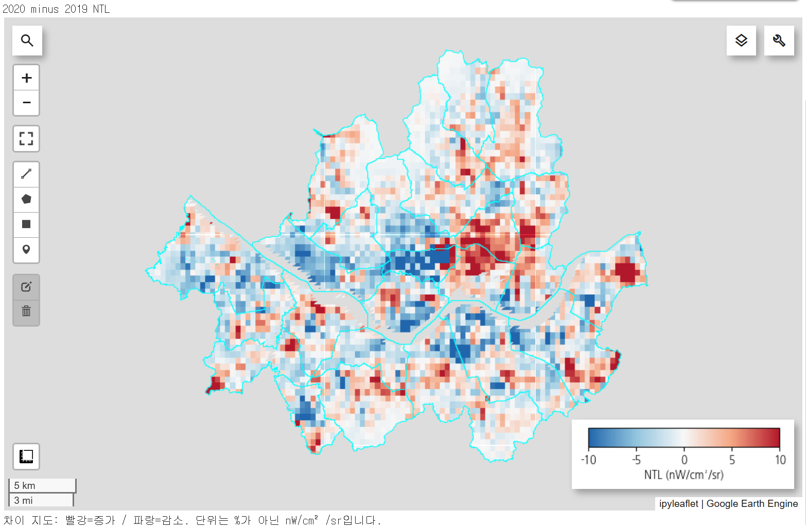 
  2019년 대비 2020년 봄철 평균 야간 복사휘도의 픽셀별 차이. 빨강은 증가, 파랑은 감소

### 5.3 세부목적 2의 분석: 회귀분석을 통한 관계 정량화

두 번째 세부목적은 서울시 25개 자치구에서 야간광량 변화와 NO₂ 변화가 어떠한 관계를 보이는지 파악하는 것이다.

이를 위해 서울시 25개 자치구를 대상으로, NO₂ 변화율을 반응변수, 야간광량 변화율을 설명변수로 하는 단순선형회귀모형을 적용하였다.

$$
Y_d=\beta_0+\beta_1 X_d+\varepsilon_d
$$

여기서 $$Y_d$$는 자치구 $$d$$의 NO₂ 변화율, $$X_d$$는 야간광량 변화율, $$\beta_0$$는 절편, $$\beta_1$$은 회귀계수, $$\varepsilon_d$$는 오차항이다. 회귀계수 $$\beta_1$$은 야간광량 변화율이 1%p 클 때 NO₂ 변화율이 평균적으로 얼마나 다르게 나타나는지를 의미한다.

   
  회귀모형 개요

회귀모형은 최소제곱법(Ordinary Least Squares, OLS)으로 추정하였다. 관계의 방향과 강도는 회귀계수 $$\beta_1$$과 95% 신뢰구간, 유의확률(p-value), 결정계수($$R^2$$)로 평가하였다. 선형 상관의 정도를 나타내는 피어슨 상관계수 $$r$$과 그 신뢰구간을 함께 산출하였으며, 이상값의 영향을 점검하기 위해 순위 기반의 스피어만 상관계수(Spearman's rho)를 보조 지표로 계산하였다. 유의수준은 $$\alpha=0.05$$로 설정하였다.

회귀모형의 잔차 정규성은 Shapiro-Wilk 검정을 통해 보조적으로 확인하였다. 다만 잔차 정규성 검정 결과만으로 회귀모형의 모든 가정이 충족되었다고 판단하지 않으며, 표본 수가 25개로 제한되어 검정력이 낮을 수 있다는 점을 고려하였다.

분석에 사용한 자료는 야간광량 요약 CSV와 NO₂ 월별 CSV이며, 자치구명을 표준화한 후 자치구명을 기준으로 두 자료를 병합하였다. NO₂ 월별 자료는 3~5월로 범위를 제한한 뒤 자치구·연도별 대표값으로 정리하고, 야간광량 자료와 동일한 자치구 단위로 연결하였다. 이후 두 지표의 변화율을 계산하여 공통 분석표를 구성하고, 전체 25개 자치구의 상관·회귀분석에 사용하였다.

분석 결과는 자치구별 원자료, 연도별 대표값, 변화량·변화율, 기술통계, 회귀분석 결과 및 시각화 자료로 저장하였다. 회귀 산점도에는 자치구별 관측값과 회귀선을 표시하고, 회귀선의 95% 신뢰대를 함께 나타내어 추정의 불확실성을 확인할 수 있도록 하였다.

### 5.4 세부목적 3의 분석 및 검증: 용도지역별 집단 구성과 상관관계 비교

### 5.4.1 LQ를 이용한 자치구별 용도지역 특성 분류

자치구별 용도지역 특성을 분류하기 위해 2019년 서울시 공식 용도지역 통계자료에서 25개 자치구의 주거·상업·공업·녹지지역 면적을 수집하였다. 각 자치구에서 네 가지 용도지역의 면적 합계를 기준으로 용도별 구성비를 계산하고, 이를 서울시 전체의 동일 용도지역 구성비와 비교하였다.

용도지역별 상대적 집중도를 파악하기 위해 입지계수(Location Quotient, LQ)를 다음과 같이 산출하였다.

$$
LQ_{d,k}=\frac{A_{d,k}/A_{d}}{A_{\text{Seoul},k}/A_{\text{Seoul}}}
$$

여기서 $$A_{d,k}$$는 자치구 $$d$$의 용도지역 $$k$$ 면적, $$A_d$$는 해당 자치구의 분석 대상 용도지역 전체 면적, $$A_{\text{Seoul},k}$$는 서울시 전체의 용도지역 $$k$$ 면적, $$A_{\text{Seoul}}$$은 서울시 전체 분석 대상 용도지역 면적이다. LQ가 1보다 크면 해당 자치구의 용도지역 구성비가 서울시 평균보다 상대적으로 높고, 1보다 작으면 낮음을 의미한다.

본 연구에서는 각 자치구의 주거·상업·공업·녹지 LQ 중 가장 큰 값을 갖는 유형을 해당 자치구의 대표 용도지역 유형으로 설정하였다. 이는 절대적인 면적 우위를 기준으로 한 분류가 아니라, 서울시 전체의 구성비와 비교한 상대적 특화 정도에 따른 분류이다.

그 결과 자치구는 상업 특화형 5개(종로구, 중구, 용산구, 강남구, 송파구), 주거 특화형 8개(광진구, 동대문구, 중랑구, 성북구, 서대문구, 마포구, 양천구, 동작구), 공업 특화형 6개(성동구, 도봉구, 강서구, 구로구, 금천구, 영등포구), 녹지 특화형 6개(강북구, 노원구, 은평구, 관악구, 서초구, 강동구)로 구분되었다. 

이 분류는 분석 시기(2019~2020년)의 토지이용 구조를 반영하기 위해, 같은 시기인 2019년 용도지역 통계를 기준으로 설정하였다.

### 5.4.2 용도지역 집단별 상관·회귀분석

분류된 네 집단을 대상으로 5.3절과 동일한 회귀모형과 상관분석을 반복 적용하였다. 각 집단 내부에서 NO₂ 변화율을 종속변수, 야간광량 변화율을 설명변수로 설정하고 OLS 회귀분석을 수행하였다. 또한 집단별 피어슨 상관계수, 스피어만 상관계수, 회귀계수, 신뢰구간, 유의확률 및 결정계수를 산출하였다.

집단별 표본 수는 상업 특화형 5개, 주거 특화형 8개, 공업 특화형 6개, 녹지 특화형 6개이다.

집단별 회귀 결과는 서울시 전체의 회귀 결과와 비교하기 위해 회귀계수, 결정계수, 상관계수를 함께 제시하였다. 집단 간 차이에 대한 통계적 검정(상호작용항 모형 등)은 수행하지 않았으며, 회귀계수와 상관계수의 방향과 크기, 95% 신뢰구간의 겹침 정도를 기준으로 기술적으로 비교하였다.

### 5.5 재현성 및 한계

본 연구는 Google Earth Engine을 이용한 위성자료 전처리 및 자치구별 공간통계 산출, Python을 이용한 자료 통합과 통계분석 순서로 수행하였다. VIIRS 자료는 월별 합성영상의 품질 및 유효 관측 조건을 적용한 후 자치구별 공간평균을 산출하였으며, Sentinel-5P NO₂ 자료는  L3 자료에 적용된 품질 기준(qa_value > 0.75)을 바탕으로 월별 평균 영상을 생성하고 3~5월 공통 유효 픽셀을 기준으로 자치구별 평균을 산출하였다. 이후 두 지표의 봄철 대표값과 전년 대비 변화율을 계산하고, 자치구별 변화율을 대상으로 상관분석 및 회귀분석을 수행하였다.

분석의 재현성을 위해 사용한 GEE 데이터셋 ID, 분석 기간, 품질 기준, 행정경계 자료, 공간 집계 해상도와 통계분석 설정을 기록하였다. 주요 설정값은 VIIRS의 최소 관측 횟수 3회(MIN_OBS=3)와 최소 유효 면적 비율 0.80(MIN_AREA_FRACTION=0.80), 월별 유효 픽셀 사용(USE_COMMON_PIXELS=False), NO₂의 L3 품질 기준(qa_value > 0.75)과 연도별 3~5월 공통 픽셀 마스크, 집계 격자 1,113.2m, 변화율 정의(전년 동기 대비 %), 유의수준 0.05이다.

다만 본 연구에는 다음과 같은 한계가 존재한다. 첫째, VIIRS와 Sentinel-5P는 관측 시점과 공간해상도가 서로 다르며, 특히 야간광량은 야간 관측자료, NO₂는 주간 관측자료를 기반으로 한다. 따라서 두 지표 간 관계를 동일 시점의 직접적인 인과관계로 해석하는 데에는 한계가 있다. 

둘째, NO₂ 기둥농도는 지표면의 실제 농도나 배출량과 동일하지 않으며, 기상 조건과 대기 중 화학반응 및 외부 지역으로부터의 이동 등에 영향을 받을 수 있다. 따라서 NO₂ 변화가 도시활동 변화만을 반영한다고 단정할 수 없다.

셋째, 자치구별 변화율을 이용한 상관분석과 회귀분석은 지역 단위의 집계자료를 바탕으로 하므로 개별 건물이나 주민의 활동 변화로 직접 일반화할 수 없다. 또한 인접 자치구 간 공간적 연관성이 존재할 수 있으나, 본 연구에서는 공간자기상관을 별도로 검정하지 않았다. 따라서 분석 결과는 자치구별 야간광량과 NO₂ 변화 사이의 통계적 연관성을 나타내는 것으로 해석해야 하며, 직접적인 인과효과를 입증하는 것으로 해석해서는 안 된다.

마지막으로 용도지역 유형은 2019년 통계를 기준으로 설정한 상대적 특화 유형이므로, 실제 산업활동이나 경제활동의 규모를 직접 나타내는 지표는 아니다. 또한 LQ가 1에 가까운 유형 간에는 분류 기준에 따라 집단이 달라질 가능성이 있으므로, 집단별 분석 결과를 해석할 때에는 이러한 분류상의 불확실성도 고려해야 한다.

## 6. 결과 {#results}
### 6.1 기초 통계 및 자료 분포

분석 대상은 서울시 25개 자치구의 2019년과 2020년 3~5월 자료이다. 야간광량은 총 150개 자치구·월 자료를 대상으로 하였으며, 품질 기준 적용 후 모든 자료가 유효한 것으로 확인되었다. 이에 따라 두 연도 모두 25개 자치구의 봄철 대표값을 확보하였다. NO₂ 자료 역시 25개 자치구별로 두 연도의 3~5월 값이 확보되어 최종 분석 표본은 25개 자치구로 구성하였다.

  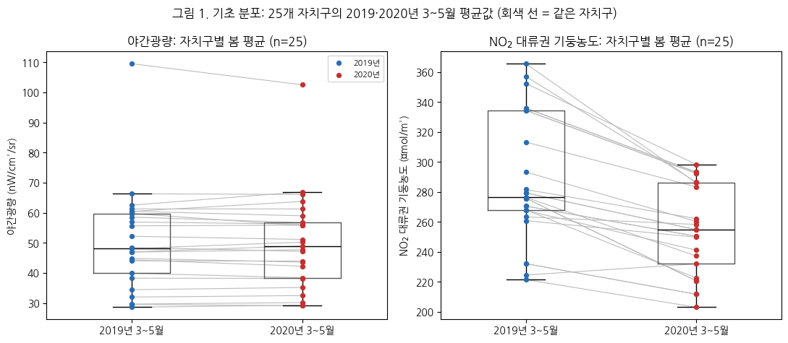 
  그림 1. 2019년과 2020년 야간광량 및 NO₂의 자치구별 분포

야간광량의 자치구별 봄철 평균 범위는 2019년 28.62~109.54 nW/cm²/sr, 2020년 29.11~102.53 nW/cm²/sr로 나타났다. NO₂의 자치구별 평균은 2019년 288.1 µmol/m²에서 2020년 254.7 µmol/m²로 감소하였다.

### 6.2 세부목적 1의 결과: 자치구별 변화율 분석

  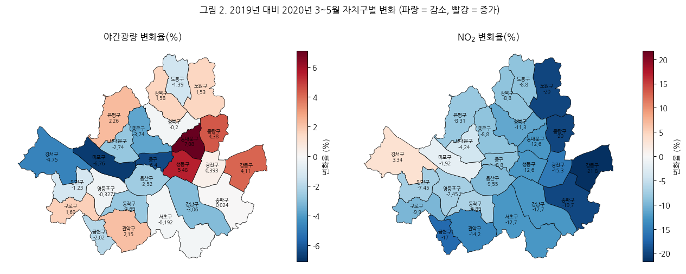 
  그림 2. 자치구별 야간광량 및 NO₂ 변화율 분포

2019년 대비 2020년 야간광량은 25개 자치구 중 11개 구에서 증가하고 14개 구에서 감소하였다. 변화율의 중앙값은 -0.20%였으며, 범위는 -6.76~+7.08%로 나타났다. 동대문구(+7.08%), 성동구(+5.48%), 중랑구(+4.38%)에서 증가 폭이 컸으며, 마포구(-6.76%), 중구(-6.40%), 강서구(-4.75%)에서는 감소 폭이 컸다.

NO₂는 25개 자치구 중 24개 구에서 감소하였으며, 평균 변화율은 -11.10%였다. 변화율은 -21.76~+3.34% 범위로 나타났고, 강동구에서 가장 큰 감소율(-21.76%)을 보였다. 반면 강서구는 유일하게 증가(+3.34%)하였다.

야간광량은 도심·서부(마포·중구·종로·강서)에서 감소하고 동북부(동대문·성동·중랑·강동)에서 증가했으며, NO₂는 동부에서 감소 폭이 크고 서부(강서·마포)에서 작았다.

### 6.3 세부목적 2의 결과: 야간광량과 NO₂ 변화율의 상관관계

   
  그림 3. 자치구별 야간광량과 NO₂ 변화율의 회귀분석 결과

자치구별 야간광량과 NO₂의 변화율 사이의 관계를 확인하기 위해 피어슨 상관분석과 단순선형회귀분석을 실시하였다. 분석 결과, 피어슨 상관계수는 -0.589(95% 신뢰구간: -0.80~-0.25)로 나타났으며, 회귀계수는 -0.995(95% 신뢰구간: -1.583~-0.406), 결정계수는 0.347이었다. 스피어만 순위상관계수 역시 -0.560으로 음의 관계를 보였다. 회귀계수와 상관계수는 모두 유의수준 0.05에서 통계적으로 유의하였다(p = 0.002, 스피어만 p = 0.004).

회귀계수가 음수라는 것은 야간광량 변화율이 높은 자치구일수록 NO₂ 변화율이 낮아지는 경향을 의미한다. 즉, 야간광량의 감소 폭이 상대적으로 작거나 증가한 지역일수록 NO₂의 감소 폭은 커지는 관계가 나타났다.

이 관계가 자료 문제나 특정 자치구에 좌우되는지 확인하기 위해 두 가지 민감도 분석을 실시하였다. 먼저 일부 자치구 쌍에서 NO₂ 값이 서로 같게 나타나는 문제가 확인되어, 해당 쌍을 하나의 분석 단위로 묶어 다시 분석하였다. 그 결과 회귀계수는 -1.237, 피어슨 상관계수는 -0.642로 전체 분석과 같은 음의 관계가 유지되었다. 또한 자치구를 하나씩 제외하고 25회 반복 분석한 결과, 회귀계수는 -1.18~-0.824 범위로 모두 음수였으며 모두 유의하였다(그림 4).

  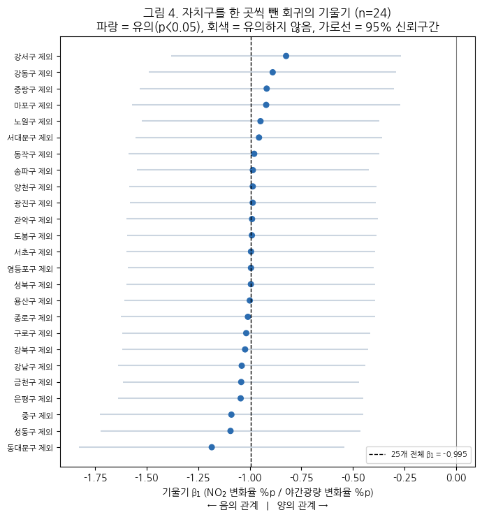 
  그림 4. 자치구 제외에 따른 회귀계수의 변화

### 6.4 세부목적 3의 결과: 용도지역 특성에 따른 관계 비교

  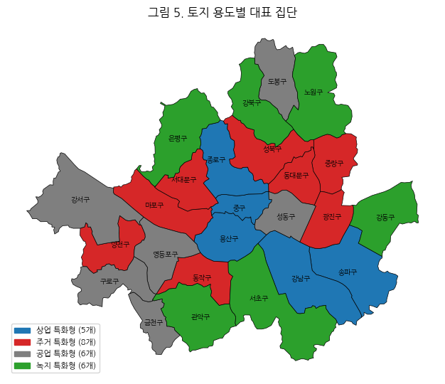 
  그림 5. 입지계수(LQ)에 따른 자치구 유형 분류 결과

2019년 용도지역 면적을 바탕으로 입지계수(LQ)를 산출하고, 네 가지 용도지역 중 가장 높은 LQ를 보이는 유형을 기준으로 자치구를 상업·주거·공업·녹지 유형으로 분류하였다. 분류 결과 상업형 5개, 주거형 8개, 공업형 6개, 녹지형 6개 자치구로 구성되었다.

  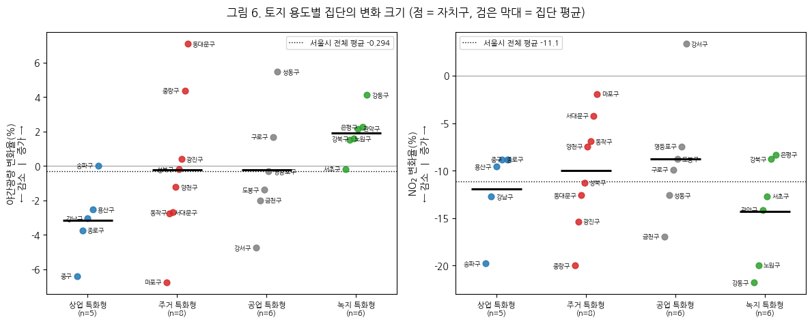 
  그림 6. 용도지역 유형별 야간광량·NO₂ 평균 변화율

유형별 평균 변화율을 비교한 결과, 야간광량은 상업형(-3.14%)에서 가장 크게 감소하였으며 녹지형(+1.91%)에서는 증가하였다. NO₂는 네 유형 모두 감소하였고, 녹지형(-14.30%)에서 감소 폭이 가장 컸으며 공업형(-8.73%)에서 가장 작았다.

유형별 상관관계 및 회귀분석 결과는 다음과 같다.

  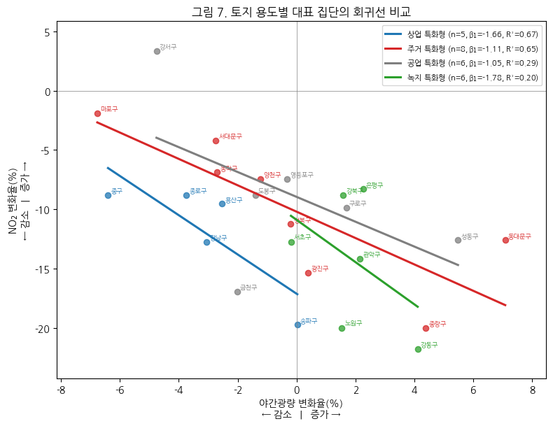 
  그림 7. 용도지역 유형별 야간광량과 NO₂ 변화율의 회귀선 비교

| 유형 | 표본 수(n) | 회귀계수 | 결정계수(R²) | 피어슨 상관계수(r) | p-value |
|---|---:|---:|---:|---:|---:|
| 상업형 | 5 | -1.656 | 0.674 | -0.821 | 0.0884 |
| 주거형 | 8 | -1.113 | 0.646 | -0.803 | 0.0163 |
| 공업형 | 6 | -1.048 | 0.291 | -0.539 | 0.2696 |
| 녹지형 | 6 | -1.782 | 0.196 | -0.443 | 0.3791 |

네 유형의 회귀계수는 모두 음수로, 서울시 전체와 같은 방향을 보였다. 즉 모든 유형에서 야간광량 변화율이 높은 자치구일수록 NO₂ 변화율이 낮은 경향이 나타났다.

관계의 강도는 유형에 따라 달랐다. 상업형(R² = 0.674, r = -0.821)과 주거형(R² = 0.646, r = -0.803)은 강한 음의 상관을 보였고 산점도에서도 음의 방향 분포가 뚜렷했다. 반면 공업형(R² = 0.291, r = -0.539)과 녹지형(R² = 0.196, r = -0.443)은 회귀선 주변의 분산이 커 경향이 약했다.

주거형만 유의수준 0.05에서 유의하였으며(p = 0.0163), 상업형(0.0884), 공업형(0.2696), 녹지형(0.3791)은 유의하지 않았다. 상관계수의 95% 신뢰구간은 상업형 -0.99~+0.22, 주거형 -0.96~-0.23, 공업형 -0.94~+0.48, 녹지형 -0.92~+0.58이었다.

네 유형의 회귀계수(-1.05~-1.78)는 서울시 전체(-0.995)와 같은 음의 방향이었으나, 신뢰구간이 서울시 전체 및 유형 간에 크게 겹쳤고 상업·공업·녹지형의 신뢰구간은 0을 포함하였다. 회귀계수의 절댓값은 녹지형과 상업형에서 컸지만, 두 유형은 신뢰구간이 넓고 유의하지 않아 기울기 크기의 차이로 해석하기는 어렵다.

  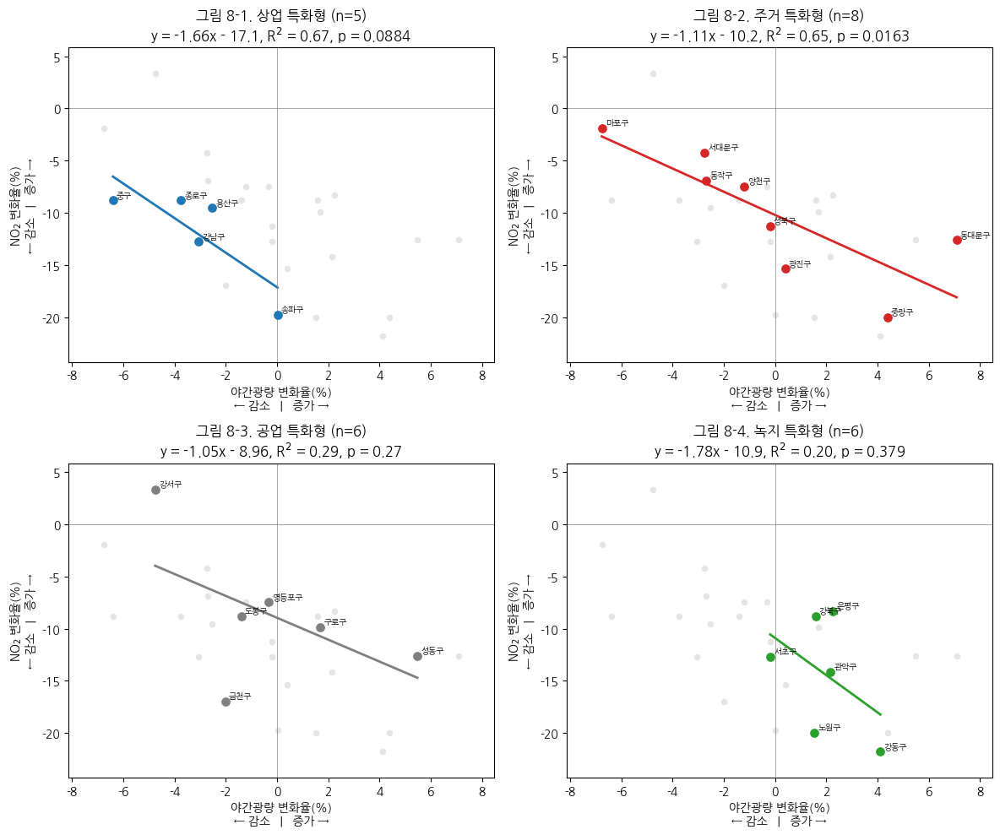 
  그림 8. 용도지역 유형별 야간광량과 NO₂ 변화율의 산점도

산점도에서 상업형과 주거형은 음의 방향 분포가 뚜렷했으나, 공업형과 녹지형은 회귀선 주변의 분산이 커 경향이 약했다. 결정계수는 상업형(0.674)과 주거형(0.646)에서 상대적으로 높았으며, 공업형(0.291)과 녹지형(0.196)에서는 낮았다. 이는 상업형과 주거형에서 야간광량 변화율을 이용한 NO₂ 변화율의 선형 설명력이 상대적으로 높았음을 의미한다. 반면 공업형과 녹지형에서는 산점의 분산이 회귀선 주변에 더 크게 나타나 두 지표 간 선형 관계의 설명력이 상대적으로 낮았다.

  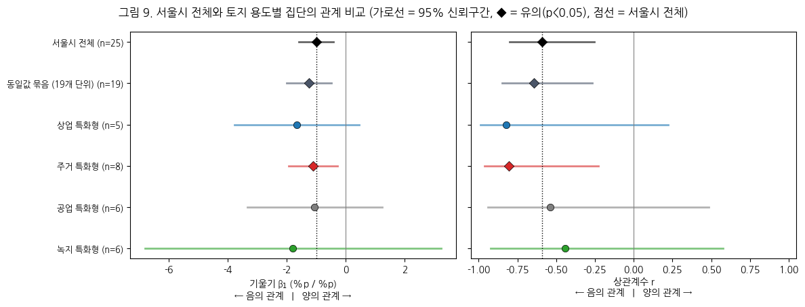 
  그림 9. 용도지역 유형별 회귀계수 및 피어슨 상관계수 비교

피어슨 상관계수는 상업형(-0.821), 주거형(-0.803), 공업형(-0.539), 녹지형(-0.443) 순으로 절댓값이 컸다. 상업형과 주거형은 강한 음의 상관관계를 보였으며, 공업형과 녹지형은 상대적으로 약한 음의 상관관계를 보였다. 95% 신뢰구간은 상업형 -0.99~+0.22, 주거형 -0.96~-0.23, 공업형 -0.94~+0.48, 녹지형 -0.92~+0.58로 나타났다. 주거형의 p-value는 0.0163으로 0.05보다 작았으며, 상업형(0.0884), 공업형(0.2696), 녹지형(0.3791)은 0.05보다 컸다.

네 유형의 회귀계수(−1.05~−1.78)는 서울시 전체(−0.995)와 같은 음의 방향이었으나, 신뢰구간이 서울시 전체 및 유형 간에 크게 겹쳤으며 상업·공업·녹지형의 신뢰구간은 0을 포함하였다.

## 7. 토의 {#discussion}
결과가 연구 질문에 주는 답과 가능한 설명을 논한다. 확인한 문헌과 비교하고, 자료·모형·평가 설계의 한계가 해석에 미치는 영향을 구체화한다. 적용 범위와 이를 넓히기 위한 후속 연구를 제시한다.

## 8. 결론 {#conclusion}
전체 연구목적과 범위를 환기한 뒤 세부목적 1·2·3에 대한 핵심 답을 근거와 함께 요약한다. 본문에 없는 새 결과·인용·주장을 추가하지 않는다. 종합적 기여와 적용 한계를 명시한다.

---

### 부록 · 재현성 및 연구 기여 {#reproduce}
실행 환경·순서·입력 위치·실행 확인일과 조원별 분석·검증·작성 기여, 참고문헌을 기록한다. 부록은 본문 8개 섹션의 번호에 포함하지 않는다.

[섹션별 작성 지침]({{ site.github.repository_url }}/blob/main/05_보고서양식/섹션별_작성지침.md)

#### 연구 배경 참고문헌

- Bauwens, M., Compernolle, S., Stavrakou, T., Müller, J.-F., van Gent, J., Eskes, H., et al. (2020). Impact of coronavirus outbreak on $\text{NO}_2$ pollution assessed using TROPOMI and OMI observations. Geophysical Research Letters, 47(11), e2020GL087978. [https://doi.org/10.1029/2020GL087978](https://doi.org/10.1029/2020GL087978).
- Elvidge, C. D., Baugh, K., Zhizhin, M., Hsu, F. C., & Ghosh, T. (2017). VIIRS night-time lights. International Journal of Remote Sensing, 38(21), 5860–5879. [https://doi.org/10.1080/01431161.2017.1342050](https://doi.org/10.1080/01431161.2017.1342050)
- 김민호. (2021). 코로나19 팬데믹에 따른 서울시 기초자치단체의 야간조도 변화. 한국지도학회지, 21(2), 105–116. [https://doi.org/10.16879/jkca.2021.21.2.105](https://doi.org/10.16879/jkca.2021.21.2.105).
- Liu, Q., Sha, D., Liu, W., Houser, P., Zhang, L., Hou, R., et al. (2020). Spatiotemporal patterns of COVID-19 impact on human activities and environment in Mainland China using nighttime light and air quality data. Remote Sensing, 12(10), 1576. [https://doi.org/10.3390/rs12101576](https://doi.org/10.3390/rs12101576).
- Seinfeld, J. H., & Pandis, S. N. (2016). Atmospheric Chemistry and Physics: From Air Pollution to Climate Change (3rd ed.).
- Venter, Z. S., Aunan, K., Chowdhury, S., & Lelieveld, J. (2020). COVID-19 lockdowns cause global air pollution declines. Proceedings of the National Academy of Sciences, 117(32), 18984–18990. [https://doi.org/10.1073/pnas.2006853117](https://doi.org/10.1073/pnas.2006853117).
- Qiming Zheng, Karen C. Seto, Yuyu Zhou, Shixue You, Qihao Weng. (2023). Nighttime light remote sensing for urban applications: Progress, challenges, and prospects. ISPRS Journal of Photogrammetry and Remote Sensing, 202, 125–141. [https://doi.org/10.1016/j.isprsjprs.2023.05.028](https://doi.org/10.1016/j.isprsjprs.2023.05.028).
- Schwaab, J., Meier, R., Mussetti, G., Seneviratne, S., Bürgi, C., & Davin, E. L. (2021). The role of urban trees in reducing land surface temperatures in European cities. *Nature Communications, 12*, 6763. [https://doi.org/10.1038/s41467-021-26768-w](https://doi.org/10.1038/s41467-021-26768-w).
